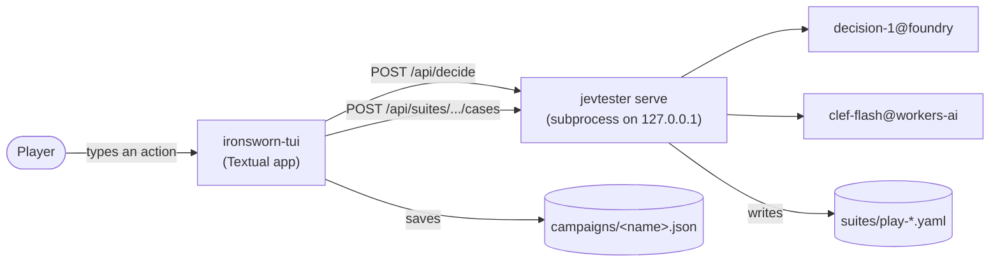

# Architecture

ironsworn-tui is a terminal app for the solo role-playing game *Ironsworn*. It's written in Python 3.14 with [Textual](https://textual.textualize.io/), a framework for terminal user interfaces. The player types what their character does. In Ironsworn, an action can trigger a *move*, a rule like Face Danger that the player rolls dice for. A *decision model* suggests which move that action triggers, and with which stat. A decision model is a hosted model that answers multiple-choice questions with a probability for each option. The player confirms the suggestion with a key, and the app rolls the dice and applies the outcome.

The code is in layers, from the Ironsworn rules at the bottom to the Textual screen at the top. For the project's status and working rules, see [`handoff.md`](handoff.md).

## The system

The app doesn't call a decision model directly. It goes through jevtester, a separate tool for testing decision models:

- When `ironsworn-tui play` starts, the app starts `jevtester serve` as a subprocess on a free port on `127.0.0.1`. It stops the server on exit.
- The app sends each turn's questions to the server's `POST /api/decide` endpoint. The server sends them to one hosted *target* and returns the answers.
- The app saves each answered turn as a test case through `POST /api/suites/{name}/cases`. jevtester writes the case to `suites/play-<context>.yaml` in this repository. The *context* is `exploring`, `journey`, or `fight`, and the app offers a different set of moves in each.

A target is a model at a provider, named `model@provider`. The default is `decision-1@foundry`, which is Microsoft-Decision-1 on Azure Foundry. The *recognizer experiment*, which measured how often a target picks the right move for hand-written player messages, also used `clef-flash@workers-ai`. That's Clef-flash on Cloudflare Workers AI. `jevtester.toml` lists the targets, and `ironsworn-tui.toml` picks the one the app asks.



`decide.jevtester_server` starts the server with `uv run --project <jevtester checkout> jevtester --config <config> serve --port <port>`. The server runs in a separate process group, so stopping it also stops the child process that `uv run` starts. Its log goes to `.jevtester/serve.log` beside the config. Starting jevtester for each request would add about 0.7 seconds, so the app keeps one server running.

The app works without a server. `ironsworn-tui play --no-model` starts none, and if the server fails to start, play goes on without suggestions. Each message then gets the full move list.

## Package layout

### The `ironsworn_tui` package

| Module | Its job |
|---|---|
| `__main__.py` | Runs the CLI for `python -m ironsworn_tui`. |
| `cli.py` | The `ironsworn-tui` command and its subcommands: `new`, `play`, `suggest`, and `write-suites`. It loads the settings, starts the jevtester server, and creates the turn engine and the app. |
| `app.py` | The Textual app: the character panel, the log, the suggestion bar, the input line with its command completion (`CommandInput`), and the pop-up screens for inputs, boosts, and dice. It calls the turn engine and the commands for everything except drawing the screen. |
| `commands.py` | The `/` commands, like `/oracle`, `/vow`, and `/asset`, and `REGISTRY`, which describes each command's arguments, options, and help. It has no UI code. |
| `registry.py` | The registry's building blocks: `Arg`, `Command`, and `Registry`, which parses a command line, completes it, and writes its help and usage. Parsing, completion, and help all read the same registry, so they can't disagree. It has no UI code. |
| `turn.py` | The turn engine, `TurnEngine`. It takes one chat message from text to applied outcome, with no UI code. |
| `campaign.py` | The saved campaign: the character, vows, bonds, foes, journey, follow-ups, lasting effects, and log. The campaign is a set of pydantic models, saved as JSON. |
| `assets.py` | Owning assets: buying and upgrading them with experience, and changing their meters, fields, and debilities. |
| `outcomes.py` | What each move's result does to the campaign, as a hand-written table of effects. |
| `abilities.py` | What each asset ability does to a roll, as a hand-written table of boosts. It also defines the lasting effects. |
| `moves.py` | Which moves the chat can trigger in each context, and the stat question for each move. |
| `criteria.py` | The descriptions of the `move` question's options, in two styles. Play uses `guide`. `trigger` uses the trigger text from Datasworn, a machine-readable copy of Ironsworn's moves, assets, and oracle tables. The recognizer experiment still uses `trigger`. |
| `decide.py` | Builds the decision request, runs `jevtester serve`, sends requests to it, and parses the answers. |
| `policy.py` | Turns a decision into a suggestion, with the confidence thresholds in `suites/policies/moves.yaml`. |
| `cases.py` | Builds the jevtester case for an answered turn, labeled with what the player did. |
| `settings.py` | Reads `ironsworn-tui.toml`: the jevtester checkout, the target, and the campaigns folder. |
| `experiment.py` | The recognizer experiment. It turns hand-written player messages into jevtester question sets and suites. |

### The `ironsworn_tui/rules` package

The rules package is a typed port of `iron.py` from the Ironsworn referee plugin. It has the rules for dice, rolls, progress, momentum, and oracles. It doesn't import anything outside `rules/`.

| Module | Its job |
|---|---|
| `datasworn.py` | Loads the vendored Datasworn data into typed, read-only indexes of moves, oracle tables, assets, and NPCs. `datasworn()` returns one cached copy. |
| `dice.py` | Dice, challenge dice, and the three results (`Hit`): strong hit, weak hit, and miss. |
| `action.py` | Action rolls and burning momentum. |
| `progress.py` | Progress tracks, ranks, and progress rolls. |
| `momentum.py` | Momentum limits and the momentum reset. |
| `suffer.py` | Endure Harm and Endure Stress. |
| `oracles.py` | The yes/no oracle and the oracle tables. |
| `errors.py` | The exceptions the rules raise. |

### Data and other folders

| Folder | What it contains |
|---|---|
| `ironsworn_tui/data/datasworn/` | The Datasworn data for Ironsworn, copied unchanged from the referee plugin. `datasworn.py` reads `moves.yaml`, `npcs.yaml`, `rules.yaml`, and the YAML files in `assets/` and `oracles/`. No code reads `atlas.yaml` or `truths.yaml` yet. `LICENSE.md` gives the upstream commit and the licenses. |
| `suites/` | jevtester files. `play-<context>.yaml` contains the cases saved in play. `recognizer-*.yaml` are the experiment's suites, `question-sets/` contains the questions each suite asks, and `policies/` contains the thresholds. `write-suites` regenerates the question sets and recognizer suites. It never rewrites a play suite, because play suites contain the cases saved in play. |
| `experiments/` | `recognizer-phrasings.yaml`, the hand-written player messages the recognizer suites are built from, and `results.md`, the accuracy results. |
| `scripts/` | `screenshots.py`, which draws the SVG screenshots in `docs/images/`. |
| `tests/` | The tests. `tests/fixtures/` contains recorded jevtester responses. |
| `diary/` | The dev diary, one entry per milestone. It isn't part of the docs site. |

## Layers and dependency direction

The code is in layers. Each layer may import from the layers below it, and never from the layers above. From the bottom up:

| Layer | Modules | Must not import |
|---|---|---|
| 1. Rules and Datasworn models | `rules/*` | Anything outside `rules/` |
| 2. Moves and contexts | `moves.py` | Anything but `rules/` |
| 3. Outcomes and abilities | `outcomes.py`, `abilities.py` | The campaign model, the turn engine, the decision code, the commands, or the UI |
| 4. Campaign model | `campaign.py`, `assets.py` | Outcomes, abilities, the turn engine, the decision code, the commands, or the UI |
| 5. Turn engine | `turn.py` | The commands, the app, the CLI, or Textual |
| 6. Commands | `registry.py`, `commands.py` | The app, the CLI, or Textual |
| 7. App and CLI | `app.py`, `cli.py` | Nothing is above them |

The decision code sits beside layers 2 to 4. `criteria.py`, `decide.py`, `settings.py`, `policy.py`, and `cases.py` import only `moves.py`, `rules/`, and each other. Inside the package, the turn engine, the CLI, and `experiment.py` import them, and `app.py` imports the `Suggestion` type from `policy.py`. Only the CLI uses `experiment.py`.

Only `app.py` imports Textual or Rich. Inside the package, only `cli.py` imports `app.py`. So the tests can drive whole turns through `TurnEngine` and `run_command` without a screen.

### Where the code breaks the layering

These imports break the layering. They're still in the code:

- `outcomes.py` imports the `Meter` and `Debility` types from `campaign.py`. So layer 3 depends on layer 4, though only for two type aliases. There's no import cycle, because `campaign.py` imports neither `outcomes.py` nor `abilities.py`. Moving the two aliases below both modules would fix it.
- `scripts/screenshots.py` imports `STATS`, `Dice`, `FixtureDecider`, and `engine` from `tests/support.py`. A change to the test helpers can break the script.

## One turn, end to end

The module docstring of `turn.py` gives the order the app calls the engine in. This section follows one turn through the code.

1. **The player types.** `IronswornApp.submit` refuses every line while a roll card is waiting, and every line but a `/` command while a follow-up is owed. A line that starts with `/` goes to `run_command`. Any other line goes to `TurnEngine.log_message`, which logs and saves it.
2. **The app asks the decision model.** `IronswornApp.ask` runs `TurnEngine.decide` in a worker thread, so the screen stays responsive. `decide` only reads the campaign. It builds a `TurnState` from the campaign and calls `decide.build_request`. The request has a `move` question and a stat question for each move that offers a choice of stats. The `move` question has one option per move in the context, plus `no_move` and `cannot_tell`. A `JevtesterClient` sends the request, and `parse_decision` returns a `Decision`.
3. **The policy makes a suggestion.** `policy.suggest` turns the `Decision` into a `Suggestion` with a *band*, a label for how many moves the bar offers. At or above the `act` threshold of 0.7, the bar preselects the one move. At or above the `confirm` threshold of 0.4, it offers the top two. Below that, or when the request failed, the band is `escalate` and the bar offers the full list. When the top answer is `no_move` or `cannot_tell`, the band is `no_roll`. Back on the UI thread, `IronswornApp.answer` calls `TurnEngine.accept`. The engine keeps the decision, so the player's move can label it later.
4. **The player confirms.** The bar is in its `suggest` mode. The player picks a move, a stat, an add, and any boosts, then presses Enter. If the move needs inputs, like a vow's name and rank, `InputsScreen` asks for them first.
5. **The engine rolls.** `TurnEngine.make_move` runs every check first. Then it changes the campaign, rolls, and returns a `RollCard`. The card contains the roll, the result, and the effects from `outcomes.outcome`, changed by the boosts the player turned on. `burn`, `reroll`, and `late_add` can change the card before it resolves.
6. **The player picks choices.** In `card` mode, the player picks options for each `Choose` effect on the card.
7. **The engine resolves the card.** `TurnEngine.resolve` checks the choices against the card and applies each effect. In a fight, it updates initiative. It logs the result's text, the picks, each change, and a `next` line, then saves the campaign and returns the follow-ups still owed. The changes come from comparing a snapshot of the campaign, `TurnEngine._state`, before and after, so a new effect kind is logged without its own log code.
8. **Follow-ups are owed.** A `FollowUp` effect adds an `OwedMove` to `Campaign.follow_ups`. In `follow_up` mode, the player makes each one in order. Pay the Price goes to `pay_the_price` and Forsake Your Vow to `forsake`. The rolled follow-ups go to `roll_follow_up`: Endure Harm, Endure Stress, Companion Endure Harm, Face Death, Face Desolation, and Scrape By.
9. **The engine saves the campaign.** `TurnEngine.save` calls `Campaign.save`. It writes the JSON to a temporary file, then replaces the real file, so a crash can't leave half a file. The engine saves after each change.
10. **The engine logs the case.** The player's move, or `n` for no move, calls `TurnEngine._record`. It builds a case with `cases.build_case` and sends it to the server, which adds it to `suites/play-<context>.yaml`. If the player didn't take the model's top answer, the case is tagged. The tag is `abstained` when that answer was `cannot_tell`, and `corrected` otherwise. Escape calls `TurnEngine.skip`, which saves nothing.

`TurnEngine.suggest` does steps 1 to 3 in one call, with no worker thread. The tests use it.

The engine stores the owed follow-ups, the next move's add, Turn the Tide, the End the Fight offer, Draw the Circle's harm boasts, and a rolled card that isn't resolved in the campaign, so they survive a restart. It doesn't store a decision waiting for a move.

`TurnEngine.save` writes the waiting card to `Campaign.pending_card` as a `SavedCard`: the move, the dice, the boosts, and the facts the outcome depends on. The card's effects aren't saved. When an engine starts on a campaign with a saved card, `TurnEngine._restore` works the effects out again with `_card`, against the campaign as it was saved with the card. So a new fact that changes a card's effects must go in `_Pending` and `SavedCard` too, or a restored card can differ.

## Key data types

| Type | Where | What it is |
|---|---|---|
| `Campaign` | `campaign.py` | Everything saved about one campaign: the character, vows, bonds, foes, journey, follow-ups, lasting effects, and log. `Campaign.context` works out the context from the foes and the journey. |
| `Character` | `campaign.py` | The character: stats, meters, momentum, debilities, owned assets, experience, and the harm they inflict. |
| `OwedMove` | `campaign.py` | A follow-up move that a result called for and that the player still owes, with its amount, vow, or companion. |
| `Lasting` | `campaign.py` | A lasting effect in the campaign, like an elixir. Its `kind` is a key of `abilities.LASTING`. |
| `RollCard` | `turn.py` | A rolled move waiting to resolve. It contains the roll, the result, the effects, the result text, and whether burning, a reroll, or a late add is available. It's frozen, so the engine replaces it on each change. |
| `MoveInputs` | `turn.py` | What some moves need before rolling, like a vow's name and rank, or each foe's name and rank. |
| `Effect` | `outcomes.py` | One thing a result does. Each kind is a frozen dataclass, and `Effect` is the union of all the kinds. |
| `Boost` | `abilities.py` | One way an asset ability changes a move. The player turns it on before rolling. It can add to the roll, roll a different stat, add harm, allow a reroll, add effects on a result, and more. |
| `ABILITIES` | `abilities.py` | Each asset ability, by `(asset id, ability number)`. Each maps to its boosts, to an `AssetMove`, or to a `Reminder` with the reason the app doesn't apply it. |
| `LASTING` | `abilities.py` | Each kind of lasting effect: the boost it gives and when it ends (`use`, `one`, `low`, or `manual`). |
| `MoveGroup` | `moves.py` | How a move starts: `FICTION` (the model can suggest it), `AFTER_RESULT`, `OUTCOME`, `COMMAND`, or `LIST` (only on the full list). |
| `Context` | `moves.py` | `EXPLORING`, `JOURNEY`, or `FIGHT`. The context sets which moves the `move` question offers. `context_options` returns them in a fixed order. |
| `TurnState`, `Decision` | `decide.py` | The state the model sees, and one target's parsed answers. |
| `Suggestion`, `Thresholds` | `policy.py` | What the suggestion bar offers, and one target's confidence thresholds. |

The effect kinds fall into these groups:

- Meters and momentum: `Momentum`, `MeterChange`, `MomentumFromMeter`, and `MaxSpirit`.
- Progress and tracks: `MarkProgress`, `CompleteVow`, `Recommit`, `EndJourney`, `RemoveTarget`, `InflictHarm`, and `InflictRolledHarm`.
- Fights: `SetInitiative`, `FoeHarmForFight`, and `HarmForFight`.
- Moves to come: `FollowUp`, `AddToNextMove`, and `RollTable`.
- Debilities, experience, and stats: `MarkDebility`, `ClearDebility`, `MarkExperience`, `GainExperience`, `ExperiencePerAbility`, and `RaiseStat`.
- Assets and companions: `AssetMeterChange`, `AssetMeterFromRank`, `AssetMeterFromActionDie`, `SetAssetMeter`, `AssetDebility`, `DiscardAsset`, `CompanionHealth`, `MaskTrack`, and `AddLasting`.
- Player choices: `Choose`, which contains `Option`s. Each option has a list of effects.
- Text the app can't apply: `Note`. The player applies it with `/adjust`.

`TurnEngine._apply_one` applies every kind, in one `match` statement.

## Design rules and why

### The app never decides fiction

The app applies the rules, but it never judges what's true in the story. So the player turns each boost on. For example, Archer's "Hunting" boost applies only when the character is hunting, and only the player knows that. `TurnEngine.boosts_for` lists the boosts that could apply, and the player chooses. Choices in an outcome, like which cost to pay on a weak hit, also come back to the player through `resolve`. The decision model only suggests a move and a stat, and the player always confirms.

### Follow-ups block other moves

The rulebook says to make a move that a result calls for, like Pay the Price after a miss, before anything else. So `make_move` raises `TurnError` while `Campaign.follow_ups` isn't empty, and the app refuses typed messages. Commands still work, so the player can ask the oracle or use `/adjust` while a follow-up is owed.

### Checks come before changes

`make_move` checks everything before it changes the campaign: the waiting card, owed follow-ups, the move, the inputs, the boosts, and the stat. So a refused move changes nothing, and the player can fix the input and try again. `resolve` works the same way: it checks the choices against the card before it applies anything. `test_a_refused_move_changes_nothing` in `tests/test_turn.py` tests this.

### Strict pydantic models and the schema version

The Datasworn models in `rules/datasworn.py` are frozen, so no code can change the one cached copy. The move and asset models also reject unknown keys, so a renamed Datasworn key fails at load instead of being dropped. The campaign models reject unknown keys and check each value when it's assigned, so a bad value fails where it's set, not at the next save. They aren't frozen, because the engine changes the campaign in place. `Campaign.load` also runs `Campaign.check`, which raises an error if parts disagree, like a target that isn't one of the foes.

`Campaign.schema_version` is `Literal[4]`, so a file with any other version doesn't load. Raise `SCHEMA_VERSION` when the campaign format changes. There's no code to migrate old files.

### No credentials are stored

The app stores no keys or tokens. jevtester signs in to each target: Foundry through the `az` sign-in, and Workers AI through the Wrangler sign-in or `CLOUDFLARE_API_TOKEN`. `jevtester.toml` has placeholders for account details. The user's real values go in `jevtester.local.toml`, which git ignores, and `settings.py` uses it when it exists.

### Live model calls are behind `-m live`

A hosted model costs money and needs the network, so the default test run never calls one. `pyproject.toml` sets `addopts = "-m 'not live'"`. A test that calls a model sets `pytestmark = pytest.mark.live`, so it runs only with `uv run pytest -m live`. The other tests use recorded responses or `FixtureDecider`.

### No suppression comments

`tests/test_style.py` fails if any Python file in `ironsworn_tui/`, `scripts/`, or `tests/` contains `noqa`, `type: ignore`, or `pyright: ignore`. Fix the finding in the code instead. Pyright runs in strict mode.

## How to make common changes

After each change, run the gates in [Testing](#testing). If your change affects what the player sees, update the user docs: `getting-started.md`, `how-to.md`, `reference.md`, or `playing.md`. If a screen changed, run the screenshot script.

### Add or change a move outcome

1. In `outcomes.py`, write or edit the move's rule. A rule is a function `(hit, details) -> tuple[Effect, ...]` that returns the effects for each result. Work from the move's text in `data/datasworn/moves.yaml`, or in the asset's YAML file for an asset move.
2. Add a new rule to `OUTCOMES` for a core move, or to `ASSET_MOVE_OUTCOMES` for an asset move.
3. If no effect kind fits, add a frozen dataclass to `outcomes.py` and add it to the `Effect` union. Then add a `case` for it to `TurnEngine._apply_one` in `turn.py`. If the app can't apply it at all, use a `Note`.
4. Test the table in `tests/test_outcomes.py`. Its tests check every move, for example that every result has an entry and that each amount appears in the result text. Test what the engine does in `tests/test_turn.py`, or in `tests/test_asset_moves.py` for an asset move.

### Add an asset ability boost

1. In `abilities.py`, find the ability in `ABILITIES` by `(asset id, ability number)`. Abilities are numbered from 1. Replace its `Reminder` with a tuple of `Boost`s, or edit the boosts it has. Each `Boost` has a `label`, the `moves` it applies to, and fields for what it changes.
2. If your boost needs a new kind of change, add a field to `Boost`. Then handle it in `turn.py`, usually in `TurnEngine._why_not` or `make_move`, or in `abilities.boost_effects`.
3. Test the table in `tests/test_abilities.py`, which checks that boosts name real moves and stats the data offers. Test the boost on a roll in `tests/test_boosts.py`, with `engine()` from `tests/support.py`.

A lasting effect works the same way. Add a `LastingKind` to `LASTING`, and an `AddLasting` effect to the outcome that starts it.

### Add a `/` command

1. In `commands.py`, write a `_name(engine, values) -> CommandResult` function. `values` holds one string for each argument given, already checked against the argument's options. Raise `UsageError` for a bad argument the registry can't check, so the error shows the usage, and `CommandError` for anything else. Change the campaign through a `TurnEngine` method where one exists, log what changed, and call `engine.save()`.
2. Add a `Command` to `REGISTRY` with the name, a one-line summary, the function, and an `Arg` for each argument. Give an `Arg` fixed options as a tuple, or a function of the engine and the earlier values for options that depend on the campaign, such as vow names. For a command with forms, such as `/vow swear`, give `subcommands` instead. Write `help` for a new player and at least one example. Completion, `/help`, and the usage in errors come from this entry.
3. If your command needs new engine behavior, add a public method to `TurnEngine` in `turn.py`.
4. Test the command in `tests/test_commands.py` with `run_command(engine, "/name ...")`, and its options in `tests/test_registry.py` with `REGISTRY.complete`. `test_every_command_has_plain_help` checks the help. Document it in `docs/reference.md`.

### Add a key or a bar mode

The suggestion bar takes keys according to `BarState.mode`, which is `idle`, `thinking`, `suggest`, `card`, `follow_up`, or `offer`.

1. To add a key to a mode, add a branch to that mode's handler in `app.py`: `_suggest_key`, `_card_key`, `_follow_up_key`, or the `offer` cases in `bar_key`. Check that no other key in the mode uses it, including `STAT_KEYS`, `PAY_KEYS`, and the digits. Add the key to the hints the bar shows in that mode.
2. To add a mode, add it to the `Mode` type and add a `case` to `bar_key` and to `render_bar`. Set the mode where the bar should enter it, usually in `after_turn`.
3. Put the game logic in `TurnEngine`, not in `app.py`, and test it in `tests/test_turn.py`.
4. Test the key with Textual's pilot in `tests/test_app.py`. Document it in `docs/reference.md`.

### Change a decision question

First read [`decision-model-guidance.md`](decision-model-guidance.md). It lists what the vendors advise and what the experiments measured.

1. Make the change. The question text is in `decide.py` (`MOVE_INSTRUCTIONS` and `STAT_INSTRUCTIONS`). The state the model sees comes from `TurnState.to_json`. The option descriptions are in `criteria.py`, and the moves each context offers are in `moves.py`.
2. Run `uv run ironsworn-tui write-suites` to regenerate the question sets and recognizer suites. `tests/test_experiment.py` fails until they match what play sends.
3. Re-record `tests/fixtures/decide-exploring-ditch.json`, because `tests/test_decide.py` checks that its request still matches `build_request`. `tests/fixtures/README.md` describes the fixtures.
4. Before play relies on the change, measure it on the recognizer suites with `jevtester run` and `jevtester report`. Record the numbers in `experiments/results.md`.

A new `move` option also needs a rule in `suites/policies/moves.yaml`.

## Testing

### The gates

Run these four gates from the repository root before every commit. All must pass.

```sh
uv run ruff format --check
uv run ruff check
uv run pyright
uv run pytest
```

The docs site has a separate check: `uv run zensical build --clean` must report "No issues found".

### Test layout

Most modules have a test file named after them. For example, `test_turn.py` tests `turn.py`, and `test_progress.py` tests `rules/progress.py`. `policy.py` has no file of its own: `test_turn.py` tests its bands, and `test_experiment.py` tests the policy file. A few features have separate files:

- `test_boosts.py` tests boosts on a roll.
- `test_asset_moves.py` tests asset moves, lasting effects, and companions.
- `test_jevtester_server.py` starts and stops a stand-in for `jevtester serve`.

### Test helpers

`tests/support.py` has the shared helpers:

- `engine(tmp_path)` returns a `TurnEngine` with its `Dice` and `FixtureDecider`. The engine plays the test character Kira, a hunter with Archer, Hawk, and Wright, who has one epic vow. It saves the campaign under `tmp_path`.
- `Dice` is a `random.Random` that returns queued rolls. Call `dice.load(action_die, challenge_1, challenge_2)` before a roll. It fails if a roll is missing or out of range.
- `FixtureDecider` answers each request with a queued move, stat, and top probability. Append `(move, stat, probability)` to `decider.answers`. It records each request in `decider.requests`.

### App tests

`tests/test_app.py` drives the real app with Textual's pilot, which presses keys in a headless app. Each test runs `app.run_test(size=(120, 40))` inside `asyncio.run` and presses keys with `pilot.press`. Then it checks `app.bar_state`, the focused widget, and `app.render_bar()`. The `settle` helper waits for the decision worker to finish.

### Live tests

`test_decide_live.py`, `test_cases_live.py`, and `test_app_live.py` call the configured target through a real `jevtester serve`. Run them with `uv run pytest -m live`. They need the jevtester checkout, a `jevtester.local.toml` with real account details, and a provider sign-in.

### Screenshots

`scripts/screenshots.py` draws the SVG screenshots in `docs/images/`. It runs the real app headlessly at 120 by 36 with the pilot, `Dice`, and `FixtureDecider`. So it calls no model and draws the same screens each time. Run it after any change to what the screen shows:

```sh
uv run python -m scripts.screenshots
```

To add a screenshot, add a drive function to `SCREENS` in the script.

## Where to read next

- [`handoff.md`](handoff.md): the project's status, what's open, gates, and working rules.
- [`plan.md`](plan.md): the build plan, the design decisions, and the build order.
- [`decision-model-guidance.md`](decision-model-guidance.md): how to write requests for decision models, and what this project measured.
- [`diary/`](https://github.com/mmacy/ironsworn-tui/tree/main/diary): the dev diary, one entry per milestone, with the reasons behind each decision.
