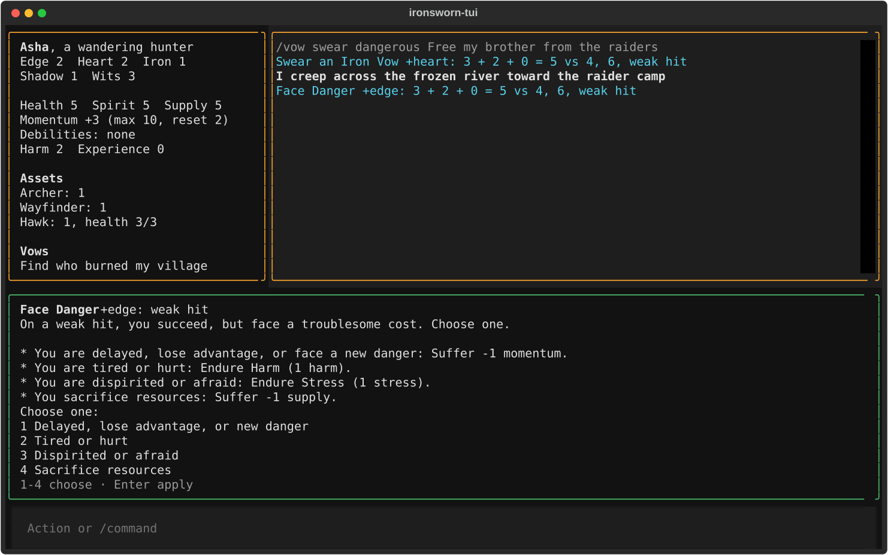
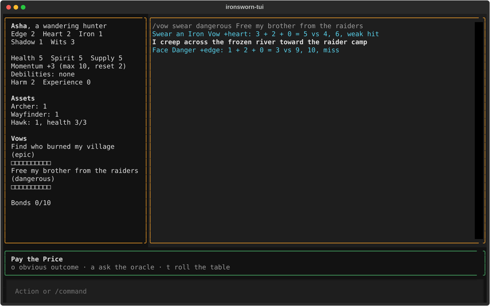

# Getting started

Install ironsworn-tui, create a character named Asha, and play her first session. You'll swear a vow, make a move, mark progress, and ask the oracle. You don't need to know *Ironsworn* first. Each rule is explained the first time you meet it, and only as far as this session needs.

For the rules in depth, see [Playing Ironsworn](playing.md). The full rules are in the *Ironsworn* rulebook, a free download from the publisher, Tomkin Press, at [tomkinpress.com](https://tomkinpress.com/products/ironsworn-digital-edition).

## Install the app

You need Python 3.14, [uv](https://docs.astral.sh/uv/), and a checkout of jevtester at `~/repos/jevtester`. jevtester is the tool the app uses to ask the decision model which move you're making.

Clone the repository:

```sh
git clone https://github.com/mmacy/ironsworn-tui.git
cd ironsworn-tui
```

Run every command in this tutorial from the `ironsworn-tui` folder. You don't need a separate install step. The first time you run `uv run`, uv installs the app's dependencies, so that first command takes a little longer.

## Check the model sign-in

The app asks a decision model, `decision-1@foundry`, which move each action triggers. That model runs on Azure, so you need to be signed in to the Azure CLI. Check your sign-in:

```sh
az account show
```

If the command shows an account, you're signed in. If it says you aren't, run `az login` and follow its steps.

If you can't sign in, you can still follow this tutorial. Add `--no-model` to the `play` command later on. The app then shows the full list of moves instead of a suggestion, and you pick the move yourself.

## Create your character

Create Asha with one command:

```sh
uv run ironsworn-tui new Asha --description "a wandering hunter" --stats edge=2,heart=2,iron=1,shadow=1,wits=3 --assets archer,wayfinder,hawk:1 --vow "Find who burned my village"
```

The command prints the full path of the new campaign file, which ends in `campaigns/Asha.json`. A campaign is your saved game: the character, their vows, and the log of everything that has happened.

Each part of the command is a choice you make about your character.

### Name and description

`Asha` is the character's name. The app also uses it as the name of the campaign file, so you'll type it again to play. `--description` is a few words about who she is. The decision model reads it, so describe her the way you'd introduce her.

### Stats

Your character has five stats. Each stat is a number you add to the dice when you act a certain way:

- Edge is quickness, agility, and skill in ranged combat.
- Heart is courage, willpower, empathy, sociability, and loyalty.
- Iron is physical strength, endurance, aggressiveness, and skill in close combat.
- Shadow is sneakiness, deceptiveness, and cunning.
- Wits is expertise, knowledge, and observation.

You give the five stats the values 3, 2, 2, 1, and 1, in any order. Put the 3 in what your character does best. Asha is a hunter who reads the land, so she has wits 3, edge 2, heart 2, iron 1, and shadow 1. The app rejects any other spread.

### Assets

Assets are cards that give your character special abilities. Each asset has three abilities, and you start with the first one marked. You pick three assets. Asha's are:

- `archer`, a combat talent for fighting with a bow.
- `wayfinder`, a path that helps on journeys and when scouting.
- `hawk:1`, a hawk companion.

A companion starts with no ability marked, so you pick one after a colon. `hawk:1` marks the hawk's first ability, which helps when Asha travels or hunts. Once you're playing, type `/asset list` to see every asset.

### Background vow

A vow is a promise your character swears to complete. Your background vow is the big goal that drives your character's whole story. `--vow "Find who burned my village"` sets Asha's. A background vow is epic, the hardest of the five ranks, so it takes a long time to fulfill.

## Start playing

Start the game:

```sh
uv run ironsworn-tui play Asha
```

The app prints `Starting jevtester for decision-1@foundry…`, then opens the game screen. The screen has four parts:

- The character panel, on the left, shows Asha's stats, meters, assets, and vows.
- The log, on the right, shows everything that happens.
- The suggestion bar, below them, shows the moves you can make and the result of each roll.
- The input line, at the bottom, says "Action or /command". You type here.


Look at the character panel. Asha has health 5, spirit 5, and supply 5. These are meters, which go down as she's hurt, shaken, or runs low on gear. The panel also shows `Momentum +2 (max 10, reset 2)`. Momentum is a measure of how well things are going. Good results raise it, and bad results lower it. You can spend it later to improve a roll.

## Swear a vow

Asha's background vow is a long-term goal. She also needs a goal for this session, and in *Ironsworn* a goal starts with a vow. Type this line and press Enter:

```text
/vow swear dangerous Free my brother from the raiders
```

A line that starts with `/` is a command, not an action. This one makes the Swear an Iron Vow move. A move is a rule that tells you what happens when your character does something risky or important. `dangerous` is the vow's rank. Ranks go from troublesome to epic, and a dangerous vow is a typical quest.

The app rolls the dice, and the suggestion bar shows a roll card. It looks like this:

```text
Swear an Iron Vow +heart: weak hit
On a weak hit, you are determined but begin your quest with more questions than answers. Take +1 momentum, and envision what you do to find a path forward.
Enter apply
```

Your result may be different, because the dice are random. The card shows the rulebook's outcome text as the app's rules data stores it, so the underscores around "weak hit" appear on screen. The new vow already appears under "Vows" in the character panel, with ten empty boxes. Press Enter to apply the result, which saves the vow. Those boxes are the vow's progress track. You fill them as you get closer to fulfilling the vow.

## Make a move

Now describe what Asha does. Type an action in your own words and press Enter:

```text
I creep across the frozen river toward the raider camp
```

The suggestion bar shows "Thinking…" while the decision model reads your action. Then it shows its suggestion, such as:

```text
1 Face Danger 0.94
Stat edge  Add +0
Enter roll · 1-9 or arrows move · e h i s w stat · + - add · n no move · Esc back
```


Read the bar from top to bottom:

- The first line lists the suggested moves. The number before each move is the key that selects it. The number after it is how sure the model is, from 0 to 1. The selected move is highlighted.
- `Stat edge` is the stat the roll will use. Creeping across ice takes agility, so the model picked edge.
- `Add +0` is any bonus you add to the roll.
- The last line lists the keys you can press.

When the model is less sure, the bar shows two moves or the full list. If you started with `--no-model`, it always shows the full list. In either case, press the number before Face Danger to select it. In the full list, it's `1`. If the bar says `Stat not set`, press `e` to pick edge.


Press Enter to roll.

## Read the roll card

The roll card shows the move, the stat, and the result. The log shows the dice:

```text
Face Danger +edge: 6 + 2 + 0 = 8 vs 1, 2, strong hit
```

Each roll works the same way. You roll a six-sided action die and add your stat and any bonus. The total is your action score. Here it's 6 + 2 + 0 = 8. Then you roll two ten-sided challenge dice, here 1 and 2. Your action score beats each challenge die that is lower than it. A tie goes to the challenge die.

There are three results:

- A strong hit means your score beat both challenge dice. You succeed.
- A weak hit means your score beat one of them. You succeed, but at a cost.
- A miss means your score beat neither. You fail, or something goes wrong.

If both challenge dice show the same number, the log adds `match`. A match means something unexpected happens in the story.

## Apply the result

What you do next depends on your result.

On a strong hit, the card says what you gain, such as "Take +1 momentum". Press Enter to apply it.

On a weak hit, the card often asks you to choose a cost:

```text
Choose one:
  1 Delayed, lose advantage, or new danger
  2 Tired or hurt
  3 Dispirited or afraid
  4 Sacrifice resources
1-4 choose · Enter apply
```



Press the number of the cost that fits the story, then press Enter. If the ice slowed Asha down, press `1`, then Enter. She loses 1 momentum, and the character panel shows it. Some costs, like `2` (tired or hurt), lead to another roll. When that happens, the suggestion bar shows the next roll and the keys to press.

On a miss, press Enter, and the suggestion bar shows Pay the Price. This move decides what goes wrong. Press `o` to take the most obvious bad outcome, then describe it in your next action.



Whatever the result, decide what it means for Asha. The app changes the numbers, and you decide what happens in the story.

## Mark progress on your vow

Say Asha reaches the raider camp without being seen. That's a step toward freeing her brother. In *Ironsworn*, a step like this is a milestone, and you mark progress on the vow. Type:

```text
/vow mark Free my brother from the raiders
```

The log shows `Reach a Milestone: Free my brother from the raiders is at 2/10`. The vow's track in the character panel now has two filled boxes. A dangerous vow fills two boxes for each milestone. A harder vow fills fewer, so it takes more milestones.

Type `/vow` to list your vows and their progress.

## Ask the oracle

Solo play has no game master to answer questions about the world. The oracle answers them instead. Say you want to know whether Asha's brother is in the camp. You think he probably is. Type:

```text
/ask likely
```

The log shows the answer, such as `Ask the Oracle (likely), 69: yes`. The word after `/ask` is how likely you think a yes is: `almost certain`, `likely`, `50/50`, `unlikely`, or `small chance`.

When you need an idea instead of a yes or no, roll on an oracle table. Type `/oracle action`, then `/oracle theme`:

```text
Oracle classic/action_and_theme/action, 13: Surrender
Oracle classic/action_and_theme/theme, 47: Freedom
```

Read the two words together and decide what they mean. "Surrender" and "freedom" might mean a raider offers to free the brother in exchange for safe passage. Type what Asha does about it, and keep playing.


## Quit and resume

Finish any roll card before you quit. The app saves after each roll is applied, but it doesn't save a card you haven't applied.

Press Ctrl+Q to quit. To pick up where you stopped, run the same command again:

```sh
uv run ironsworn-tui play Asha
```

The log shows your recent history, and the character panel shows Asha as you left her.

## Next steps

To keep learning:

- [How-to guides](how-to.md) show how to start a fight, set out on a journey, buy new assets, and fix mistakes.
- [Playing Ironsworn](playing.md) explains moves, momentum, progress, and the other rules as the app handles them.
- [Reference](reference.md) lists every key and `/` command.
