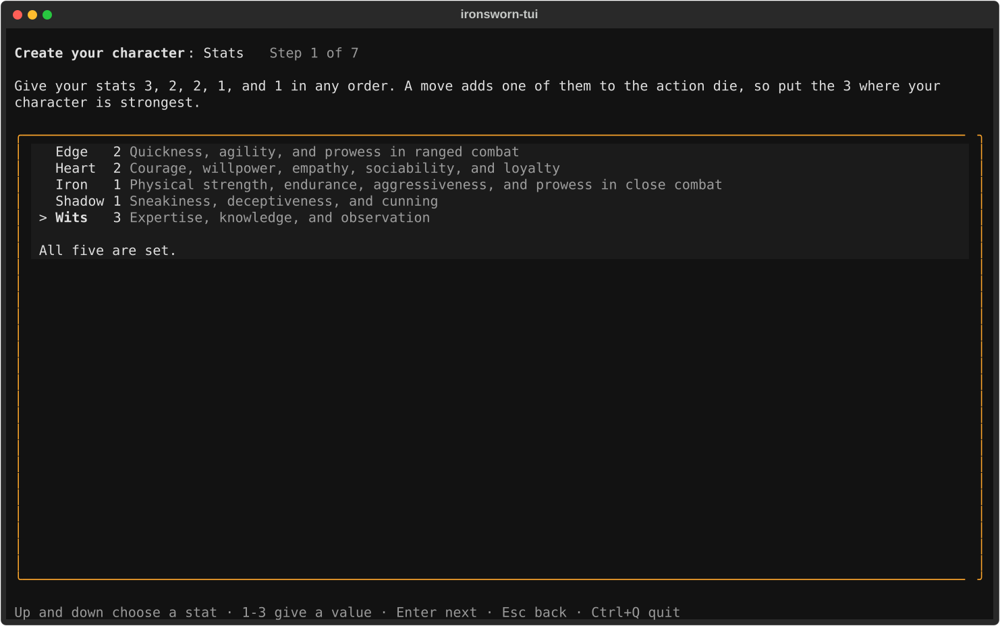
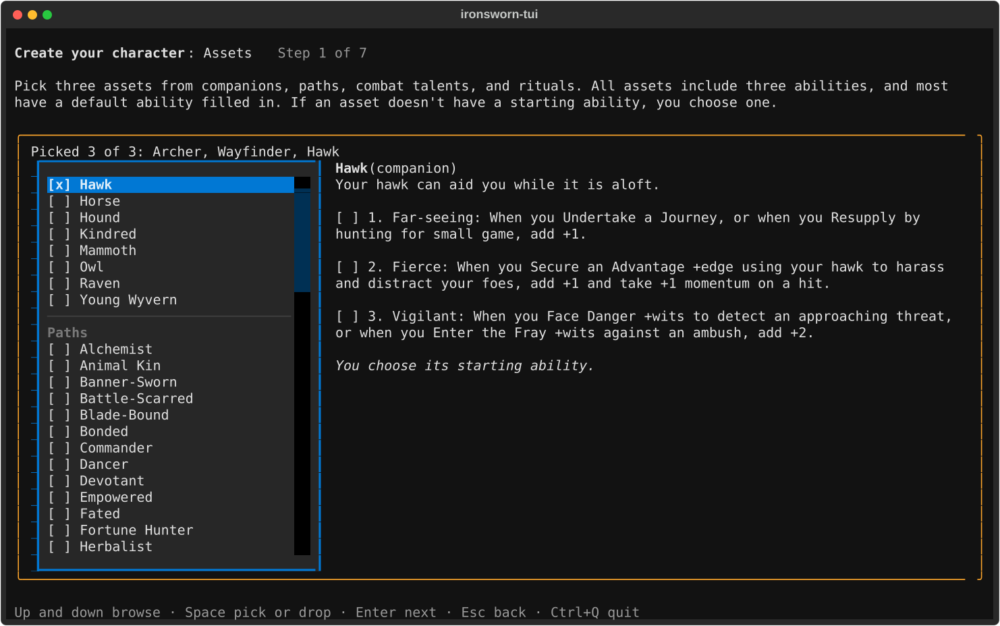
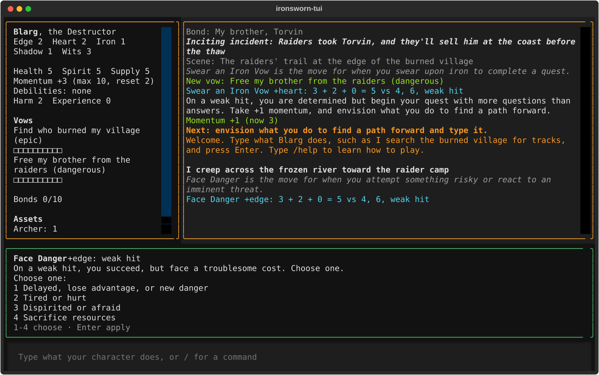
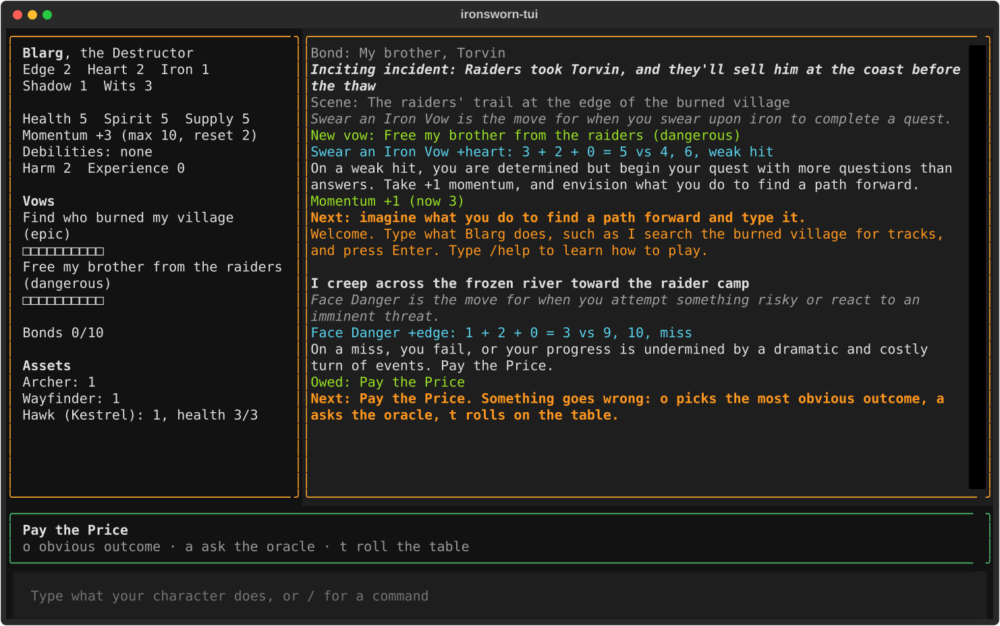
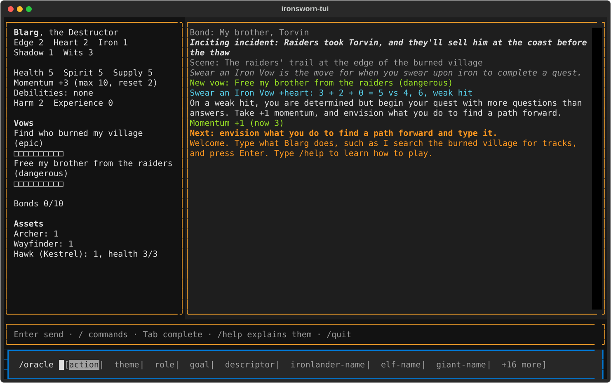

# Getting started

Install ironsworn-tui, create a character named Blarg the Destructor and their world, and play their first session. You'll swear a vow, make a move, mark progress, and ask the oracle. You don't need to know *Ironsworn* first. You'll learn each rule the first time you meet it, and only as far as this session needs.

For the rules in depth, see [Playing Ironsworn](playing.md). The full rules are in the *Ironsworn* rulebook, a free download from the publisher, Tomkin Press, at [tomkinpress.com](https://tomkinpress.com/products/ironsworn-digital-edition).

## Install the app

You need Python 3.14, [uv](https://docs.astral.sh/uv/), and a checkout of [jevtester](https://github.com/mmacy/jevtester) at `~/repos/jevtester`. jevtester is the tool the app uses to ask the decision model which move you're making. You also need your own deployment of the model, set up as [How to set up the model target](how-to.md#how-to-set-up-the-model-target) shows.

Clone the repository:

```sh
git clone https://github.com/mmacy/ironsworn-tui.git
cd ironsworn-tui
```

Run every command in this tutorial from the `ironsworn-tui` folder. You don't need a separate install step. The first time you run `uv run`, uv installs the app's dependencies, so that first command takes a little longer.

## Check the model sign-in

The app asks a decision model, `decision-1@foundry`, which move each action triggers. That model runs on Azure, so you need to be signed in to the Azure CLI. Check your sign-in:

```sh
az account show
```

If the command shows an account, you're signed in. If it says you aren't, run `az login` and follow its steps.

If you can't sign in, you can still follow this tutorial. Add `--no-model` to the `new` command later on. The app then shows the full list of moves instead of a suggestion, and you pick the move yourself.

## Create your character

Start the walkthrough:

```sh
uv run ironsworn-tui new
```

The walkthrough asks for each part of the campaign setup, in the rulebook's order. At the top, the heading names the step and counts the steps, and a line below it gives the rule for that step. At the bottom, a line lists the keys. Enter moves to the next field, and from a step's last field to the next step. Esc goes back a step and keeps your answers. Ctrl+Q quits and saves nothing.

### Name and description

Type `Blarg` and press Enter, then type `the Destructor` and press Enter. The name also names the campaign file, so you'll type it again to play. The description is a few words about who your character is. The decision model reads both, so describe them the way you'd introduce them. If you can't think of a name, press Ctrl+R to roll one.

### Stats

Your character has five stats. Each stat is a number you add to the dice when you act a certain way:

- Edge is quickness, agility, and prowess in ranged combat.
- Heart is courage, willpower, empathy, sociability, and loyalty.
- Iron is physical strength, endurance, aggressiveness, and prowess in close combat.
- Shadow is sneakiness, deceptiveness, and cunning.
- Wits is expertise, knowledge, and observation.

You set your stats by arranging the bonuses 3, 2, 2, 1, and 1 across them, in any order. Put the 3 in what your character does best. Blarg reads the land well, so they have wits 3, edge 2, heart 2, iron 1, and shadow 1.

Up and Down move between the stats, and the keys 1, 2, and 3 set the highlighted stat's bonus. Press `2` for edge, then Down and `2` for heart, Down and `1` for iron, Down and `1` for shadow, and Down and `3` for wits. If you set a bonus that's used up, the stat that had it loses it, and the line below the stats shows the bonuses left. Press Enter.



### Assets

Assets are cards that give your character special abilities. There are four kinds: companions, paths, combat talents, and rituals. All assets include three abilities, and most have a default ability filled in. You pick three.

The list on the left shows every asset by kind, and the right side shows the highlighted asset's abilities. Use Up and Down to browse, and press Space to pick or drop an asset. Pick Blarg's three:

- Archer, a combat talent for fighting with a bow.
- Wayfinder, a path that helps on journeys and when scouting.
- Hawk, a hawk companion.



Press Enter. A companion doesn't have a starting ability, so the next step asks you to choose one for Blarg's hawk, and to give it a name. Press `1` to choose the first ability, which helps when Blarg travels or hunts. Press Enter, type `Kestrel` for the hawk's name, and press Enter.

### Equipment

The equipment step asks whether your character is armed with a deadly weapon, such as a sword, axe, spear, or bow. Blarg carries a bow, so keep the first option, and press Enter. With a deadly weapon, your character inflicts 2 harm in a fight. Unarmed or with a simple weapon, they inflict 1.

## Create your world

Next, the walkthrough asks about the world. The rulebook describes 11 truths about the Ironlands, such as where the people came from and how magic works. Each truth has three options. Read them and press a number to choose one, press `r` to roll for it, or choose the last option to leave it blank and fill it in as you play. Under the options, each one's quest starter is an idea for a story. Look out for one that suggests a goal for Blarg.


Press Enter after each truth. To move faster, press `a` at any truth to roll for it and every truth after it.

Then choose where Blarg's story begins. Press `5` for the Havens, a region of forests, rivers, and low hills. Press Tab, type `Ravenford` as the name of Blarg's village, and press Enter. Ctrl+R rolls a village name if you want one.

## Bonds and vows

### Background bonds

A bond is a connection to a community or an individual. You can give yourself up to three, and you mark a tick on your bonds track for each. Type `My brother, Torvin` for the first bond and press Enter. Press Enter twice more to leave the others empty.

### Background vow

A vow is a promise your character swears to complete. Your background vow represents your character's primary motivation or ultimate goal. Type `Find who burned my village` and press Enter. You give a background vow a rank of extreme or epic, the two hardest of the five ranks, so it takes a long time to fulfill. You don't make the Swear an Iron Vow move for it. Keep epic, and press Enter.

### Inciting incident

The inciting incident is an imminent threat or compelling need that forces your character into action. The rulebook says to make it personal, make it a problem that won't go away on its own, and give it a ticking clock. Type `Raiders took Torvin, and they'll sell him at the coast before the thaw`, and press Enter. If you're stuck, Ctrl+R rolls the action and theme oracles to spark an idea.

## Set the scene

The last question is how play starts. *In media res* begins in the middle of things, as the inciting incident happens, and your character swears a vow to face it now. The normal world begins with a prologue, before the incident comes. Keep in media res, and press Enter.

Type the opening scene, `The raiders' trail at the edge of the burned village`, and press Enter. The scene tells the decision model where Blarg is.

In media res, Blarg swears a vow to face the inciting incident. Type `Free my brother from the raiders` and press Enter. The rank says how hard the vow is. Ranks go from troublesome to epic, and a dangerous vow is a typical quest. Keep dangerous, and press Enter.

The review lists every choice. Press Esc to go back and change one, or press Enter to create the campaign and play.

## Start playing

The walkthrough prints the full path of the new campaign file, which ends in `campaigns/Blarg.json`. A campaign is your saved game: the character, their world, their vows, and the log of everything that has happened. Then the app prints `Starting jevtester for decision-1@foundry…` and opens the game screen. If you couldn't sign in to the model, start the walkthrough with `uv run ironsworn-tui new --no-model` instead.

The game screen has four parts:

- The character panel, on the left, shows Blarg's stats, meters, assets, and vows.
- The log, on the right, shows everything that happens.
- The suggestion bar, below them, shows the moves you can make and the result of each roll.
- The input line, at the bottom, says "Type what your character does, or / for a command". You type here.


## Swear a vow

The walkthrough made Blarg's first move for you. A move is a rule for what happens when your character does something risky or important. Swearing a vow is the Swear an Iron Vow move, and the app has rolled the dice for it. The suggestion bar shows the roll card:

```text
Swear an Iron Vow +heart: weak hit
On a weak hit, you are determined but begin your quest with more questions than answers. Take +1 momentum, and envision what you do to find a path forward.
Enter apply
```

Your result may be different, because the dice are random. The card shows the rulebook's outcome text. The new vow already appears under "Vows" in the character panel, with ten empty boxes. Those boxes are the vow's progress track. You fill them as you get closer to fulfilling the vow. Press Enter to apply the result.

Look at the character panel. Blarg has health 5, spirit 5, and supply 5. These are meters. Health goes down when Blarg is hurt, spirit when they're shaken, and supply when they run low on gear. The panel also shows `Momentum +2 (max 10, reset 2)`. Momentum is a measure of how well things are going. Good results raise it, and bad results lower it. You can spend it later to improve a roll. On a weak hit, Swear an Iron Vow gives +1 momentum, so the panel now shows `Momentum +3`.

Later vows don't need the walkthrough. A line that starts with `/` is a command, not an action, and `/vow swear dangerous Find the raider chief` swears a new dangerous vow.

## Make a move

Now describe what Blarg does. Type an action in your own words and press Enter:

```text
I creep across the frozen river toward the raider camp
```

The suggestion bar shows "Thinking…" while the decision model reads your action. Then the bar shows the model's suggestion, such as:

```text
1 Face Danger 0.94
Face Danger is the move for when you attempt something risky or react to an imminent threat.
Stat edge  Add +0
Enter roll · 1 or arrows move · e h i s w stat · + - add · n no move · Esc back
```


Read the bar from top to bottom:

- The first line lists the suggested moves. The number before each move is the key that selects it. The number after it is how sure the model is, from 0 to 1. The selected move is highlighted.
- The dim line says what the selected move is for, so you can choose between suggestions. On a narrow screen, it ends with "…".
- `Stat edge` is the stat the roll will use. Creeping across ice takes agility, so the model picked edge.
- `Add +0` is any bonus you add to the roll.
- The last line lists the keys you can press.

When the model is less sure, the bar shows two moves or the full list. If you started with `--no-model`, it always shows the full list. In either case, press the number before Face Danger to select it. In the full list, it's `1`. If the bar says `Stat: press e edge, i iron, ...`, press `e` to pick edge.


Press Enter to roll.

## Read the roll card

The roll card shows the move, the stat, the result, and the result's text from the rulebook. The log shows the dice:

```text
Face Danger +edge: 6 + 2 + 0 = 8 vs 1, 2, strong hit
```

Each roll works the same way. You roll a six-sided action die and add your stat and any bonus. The total is your action score. Here it's 6 + 2 + 0 = 8. Then you roll two ten-sided challenge dice, here 1 and 2. Your action score beats each challenge die that is lower than it. A tie goes to the challenge die.

There are three results:

- A strong hit means your score beat both challenge dice. You succeed.
- A weak hit means your score beat one of them. You succeed, but at a cost.
- A miss means your score beat neither. You fail, or something goes wrong.

If both challenge dice show the same number, the log adds `match`. A match means something unexpected happens in the story.

## Apply the result

What you do next depends on your result.

On a strong hit, the card says what you gain, such as "Take +1 momentum". Press Enter to apply it.

On a weak hit, the card often lists costs for you to choose from:

```text
Face Danger +edge: weak hit
On a weak hit, you succeed, but face a troublesome cost. Choose one.
Choose one:
  1 Delayed, lose advantage, or new danger
  2 Tired or hurt
  3 Dispirited or afraid
  4 Sacrifice resources
1-4 choose · Enter apply
```

The rulebook lists the costs too. The card shows them only once, as the numbered options.



Press the number of the cost that fits the story, then press Enter. If the ice slowed Blarg down, press `1`, then Enter. They lose 1 momentum, and the character panel shows it. Some costs, like `2` (tired or hurt), lead to another roll. When that happens, the suggestion bar shows the next roll and the keys to press.

On a miss, press Enter, and the suggestion bar shows Pay the Price. You make this move to decide what goes wrong. Press `o` to take the most obvious bad outcome, then describe it in your next action.



Whatever the result, decide what it means for Blarg. The app changes the numbers, and you decide what happens in the story.

## Read the log

After you apply a result, the roll card closes, and the log shows a record of the whole turn. Say Blarg looks around, and the app suggests Gather Information. On a strong hit, the log shows:

```text
I look around to gain an idea of my surroundings
Gather Information is the move for when you search an area, ask questions, conduct an investigation, or follow a track.
Gather Information +wits: 6 + 3 + 0 = 9 vs 3, 4, strong hit
On a strong hit, you discover something helpful and specific. The path you must follow or action you must take to make progress is made clear. Envision what you learn (Ask the Oracle if unsure), and take +2 momentum.
Momentum +2 (now 5)
Next: imagine what you learn and type it, or ask the oracle (/ask likely for yes or no, /oracle action for ideas).
```

Each kind of line has a different color:

- Your message is bold.
- The line in dim italics says what the move is for. It appears the first time you make each move in a campaign.
- The roll is cyan.
- The result's text is plain. It's the text the roll card showed.
- On a weak hit or a miss with a choice, a magenta line says what you picked, such as "Picked: Sacrifice resources".
- Each change is green, with its new value.
- A bold yellow line that starts with "Next:" says what to do next, when the result calls for something the app can't do for you.


Here, the "Next:" line says to decide what Blarg learns. Type it as your next action, such as "I find tracks leading north to the raider camp." If you have no idea, ask the oracle, as the next sections show.

## Mark progress on your vow

Say Blarg reaches the raider camp without being seen. That's a step toward freeing their brother. In *Ironsworn*, a step like this is a milestone, and you mark progress on the vow. Type:

```text
/vow mark Free my brother from the raiders
```

The log shows `Reach a Milestone: Free my brother from the raiders, progress +2 boxes (now 2 boxes)`. The vow's track in the character panel now has two filled boxes. Each milestone fills two boxes on a dangerous vow. On a harder vow, a milestone fills fewer boxes, so you need more milestones.

Type `/vow` to list your vows and their progress.

## Ask the oracle

Solo play has no game master to answer questions about the world. The oracle answers them instead. Say you want to know whether Blarg's brother is in the camp. You think he probably is. Type:

```text
/ask likely Is my brother in the camp?
```

The log shows your question with the answer, such as `Ask (likely): Is my brother in the camp? 69: yes`. The word after `/ask` is how likely you think a yes is: `almost certain`, `likely`, `50/50`, `unlikely`, or `small chance`. The question is optional.

You don't have to remember the likelihoods. Type `/ask ` and the input line shows them in dim text, such as `[almost certain | likely | 50/50 | unlikely | small chance | help]`. Type a letter or two to narrow the list, press Up or Down to pick one, and press Tab to complete it. This works for every command: type `/` to see them all.



When you need an idea instead of a yes or no, roll on an oracle table. Type `/oracle action`, then `/oracle theme`:

```text
Oracle (action): 13: Surrender
Oracle (theme): 47: Freedom
```

Read the two words together and decide what they mean. "Surrender" and "freedom" might mean a raider offers to free the brother in exchange for safe passage. Type what Blarg does about it, and keep playing.

To keep track of what you learn, write a note. It's saved in the log:

```text
/note The raider who offered the deal is called Orrin
```

## Get help in the app

Type `/help` to list every command with a one-line summary. Add `help` after any command to learn what it's for, when to use it, and its options, such as `/oracle help` or `/vow swear help`. If you mistype a command, the log shows how to write it and which help to read.


## Quit and resume

The app saves after every change, and it saves a roll card you haven't applied too, so you can quit at any time.

Type `/quit`, or press Ctrl+Q, to quit. To pick up where you stopped, run the same command again:

```sh
uv run ironsworn-tui play Blarg
```

The log shows your recent history, and the character panel shows Blarg as you left them.

## Next steps

To keep learning:

- [How-to guides](how-to.md) show how to start a fight, set out on a journey, buy new assets, and fix mistakes.
- [Playing Ironsworn](playing.md) explains moves, momentum, progress, and the other rules as the app handles them.
- [Reference](reference.md) lists every key and `/` command.
