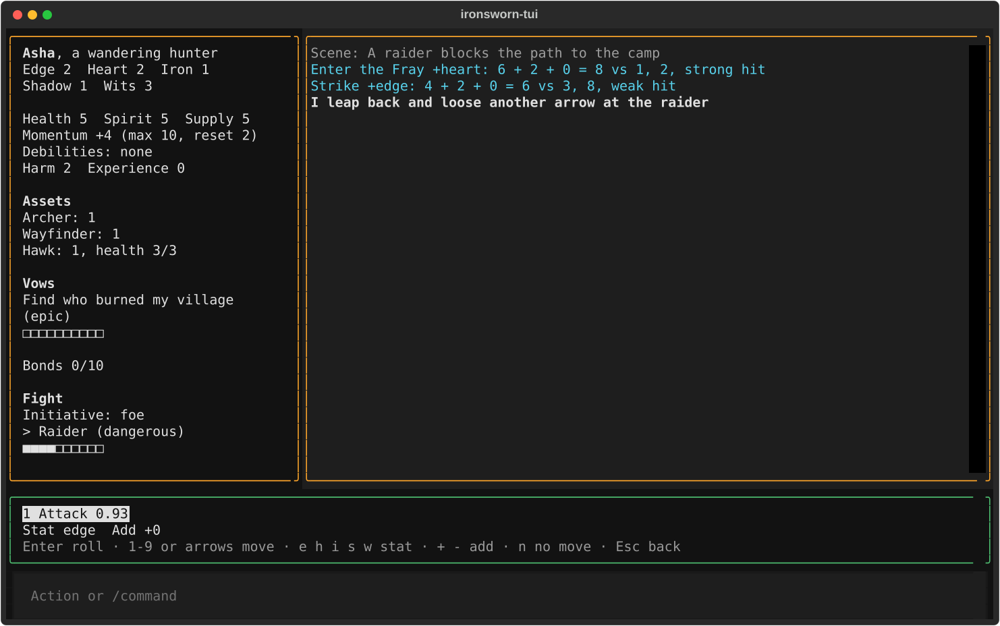

# How-to guides

If you haven't played yet, start with the [tutorial](getting-started.md). For how a move works in the rules, see [How Ironsworn plays in the app](playing.md). For every option of a command, see the [reference](reference.md).

Run the `uv run` commands from the ironsworn-tui folder. In the app, you type actions and `/` commands on the input line at the bottom, which says "Action or /command". The keys in these guides work when the suggestion bar above the input line has focus. The app gives it focus whenever it has something for you to pick. Press Tab to move focus between the log, the bar, and the input line.

## How to set up the model target

Do this before your first `play` without `--no-model`, or when you switch to another model.

The decision model suggests which move your action triggers. The app reaches it through jevtester. jevtester uses your Azure or Cloudflare sign-in, and the app stores no keys.

Before you start, you need:

- jevtester checked out at `~/repos/jevtester`. If it's somewhere else, set `jevtester_project` in `ironsworn-tui.toml` to its path.
- The Azure CLI (`az`) for `decision-1@foundry`, or Wrangler for `clef-flash@workers-ai`.

To use `decision-1@foundry`, which is the default:

1. Sign in to Azure:

   ```sh
   az login
   ```

2. Open `ironsworn-tui.toml` in the ironsworn-tui folder, and check that `target` names the model:

   ```toml
   target = "decision-1@foundry"
   ```

To use `clef-flash@workers-ai`:

1. Install Wrangler where `npx` can find it, for example with `npm install -g wrangler`. jevtester runs `npx --no-install wrangler`, so it won't download Wrangler for you.
2. Sign in to Cloudflare:

   ```sh
   npx wrangler login
   ```

   If you have a Cloudflare API token instead, set the `CLOUDFLARE_API_TOKEN` environment variable. jevtester uses it in place of the Wrangler sign-in.

3. In `ironsworn-tui.toml`, set `target`:

   ```toml
   target = "clef-flash@workers-ai"
   ```

To check the sign-in, run this from the ironsworn-tui folder:

```sh
uv run --project ~/repos/jevtester jevtester --config jevtester.toml targets check
```

When you start `play`, the terminal shows "Starting jevtester for decision-1@foundry…" with your target's name. If jevtester can't start, the game still opens, and the log shows a note that begins "Playing without move suggestions:". If a single request fails, the log shows a note that begins "No suggestion:", and the bar offers the full move list.

Clef-flash was less accurate than Decision-1 in testing, and its confidence numbers are less reliable, so check its suggestions more closely.

## How to play without the model

Use this when you have no network, no sign-in, or want to pick every move yourself.

1. Start the game with `--no-model` after the character's name:

   ```sh
   uv run ironsworn-tui play Kira --no-model
   ```

2. Type what your character does and press Enter. The log shows your message, and the bar shows the full list of moves for where you are, with none selected.
3. Pick a move. Press 1 to 9 for the first nine, or the arrow keys for any move.
4. If the bar shows "Stat not set", press e, h, i, s, or w for edge, heart, iron, shadow, or wits.
5. Press Enter to roll.

You can also type `/moves` to open the full list without typing a message first.

With the model, the app saves each message it answered, with the move you made, as a test case in `suites/play-<context>.yaml`. Without the model, it saves none.

## How to create a character with specific stats and assets

Use this to start a campaign with the character you planned on paper.

Before you start, choose:

- A name. The name also names the campaign file.
- Your stats. Give 3 to one stat, 2 to two stats, and 1 to the other two.
- Three asset ids. To see them, start any campaign and type `/asset list`, or `/asset list companion` for one category.
- For a companion, the ability it starts with, from 1 to 3.
- Your background vow.
- Up to three background bonds: people or communities your character is close to. They're optional.

Steps:

1. Run `new`. Write each companion as its id, a colon, and the ability number, such as `hawk:2`:

   ```sh
   uv run ironsworn-tui new Kira --description "a hunter" --stats edge=2,heart=2,iron=1,shadow=1,wits=3 --assets archer,hawk:2,wright --vow "Avenge my village"
   ```

2. Add any of these options if you need them:

   - `--rank` sets the background vow's rank. It's `epic` unless you give another rank: `troublesome`, `dangerous`, `formidable`, or `extreme`.
   - `--harm 1` means your character doesn't carry a deadly weapon. The default is 2.
   - `--bond` names a background bond, such as `--bond "My sister Ash"`. Repeat it for up to three bonds. Each one marks a tick on your bonds track.

The command prints the path of the new campaign file, such as `campaigns/Kira.json`. If something is wrong, it prints an error and creates nothing. For example:

- "Error: Hawk starts with no ability marked; pick one from 1 to 3" means you left off the companion's ability, as in `hawk` instead of `hawk:2`.
- "Error: stats must be assigned from (3, 2, 2, 1, 1)" means the stats don't add up that way.
- "Error: unknown asset id" means an id is misspelled.

You can't start with the first ability of Battle-scarred or Shadow-kin, because it changes your stats when you mark it. You can start with either asset's second or third ability, such as `shadow_kin:2`. To get the first ability, buy or upgrade it in play, as [How to spend experience on an asset](#how-to-spend-experience-on-an-asset) shows.

To name a companion, see [How to look after a companion](#how-to-look-after-a-companion).

## How to swear, mark, and fulfill a vow

Use this when your character makes a new promise, makes headway on one, or keeps one.

To swear a vow:

1. Type `/vow swear`, the rank, and the vow:

   ```text
   /vow swear dangerous Find my brother
   ```

2. The bar shows the roll card for Swear an Iron Vow. If the card says "Choose one:", press the number of your choice.
3. Press Enter to apply.

The vow appears under "Vows" in the panel on the left, with ten empty boxes.

To mark progress when you reach a milestone:

1. Type `/vow mark` and the vow's name:

   ```text
   /vow mark Find my brother
   ```

   If you have only one vow, `/vow mark` is enough.

The log shows "Reach a Milestone: Find my brother is at 2/10", or however full it is. The amount marked depends on the vow's rank.

To fulfill a vow:

1. Type `/vow fulfill` and the vow's name. You can leave out the name if you have only one vow.

   ```text
   /vow fulfill Find my brother
   ```

2. The bar shows a progress roll. Pick any choice the card asks for, then press Enter.

On a hit, the vow leaves the panel and you get experience. On a miss, the card asks you to recommit or forsake the vow.

Type `/vow` alone to list your vows. Type `/vow forsake` and a vow's name to give one up. You need to type the vow's name exactly as you swore it.

## How to run a fight

Use this when your character fights one or more foes.

1. Type what starts the fight, like `I charge the raiders`, and press Enter. If the model doesn't offer Enter the Fray, type `/moves` and pick it from the list.
2. Set the stat with h, s, or w, then press Enter.
3. A form titled "Enter the Fray" asks for "Foes". Type each foe as a name and a rank, with a comma between foes, then press Enter:

   ```text
   Raider dangerous, Archer troublesome
   ```

4. Press Enter to apply the roll card.

The panel now shows "Fight", who has initiative, and each foe's progress track. The foe marked `>` is the one your attacks hit.



To attack:

1. Type what your character does, like `I swing my axe`, and press Enter.
2. Pick "Attack". Attack is Strike when you have initiative and Clash when the foe does, and the roll card shows which.
3. Set the stat with i or e, and press Enter to roll.
4. Pick any choices on the card, then press Enter.

To attack a different foe, type `/target` and its name, such as `/target Archer`.

To end the fight:

1. After a strong hit on Strike or Clash, when the target has at least one full box, the bar shows "End the Fight".
2. Press f to roll End the Fight. Press Escape instead to keep fighting.
3. Pick any choices on the card, then press Enter.

On a hit, the foe leaves the fight. When no foes are left, the "Fight" section leaves the panel, and the move list goes back to the moves you use outside a fight.

To end a fight in another way, like when you flee, lose, or settle it with Battle, type `/adjust fight end`.

When a foe has initiative, `/tide` arms Turn the Tide for your next move, and `/tide off` disarms it.

## How to undertake a journey

Use this when your character travels somewhere far or dangerous.

1. Type what your character does, like `I set out for Iron Hill`, and press Enter. If the model doesn't offer Undertake a Journey, type `/moves` and press 7.
2. Press Enter to roll.
3. The first time, a form titled "Undertake a Journey" asks for "Destination" and "Rank". Type the destination, press Enter, type the rank, and press Enter.
4. If the card says "Choose one:", press the number of your choice, then press Enter.

The panel shows "Journey" with the destination and its progress track. Repeat these steps for each leg. The form doesn't appear again while the journey is active.

To reach your destination:

1. Type `/moves`, or type what your character does on arrival.
2. Press the arrow keys to select "Reach Your Destination". During a journey, it comes right after Write Your Epilogue.
3. Press Enter to make the progress roll.
4. Pick any choices on the card, then press Enter.

On a hit, the journey ends and leaves the panel. On a miss, the card asks whether the journey continues or ends.

## How to ask the oracle or roll on an oracle table

Use this when you want the oracle to answer a question or inspire a detail.

To ask a yes or no question:

1. Decide how likely a yes is: `almost certain`, `likely`, `50/50`, `unlikely`, or `small chance`.
2. Type `/ask` and the likelihood:

   ```text
   /ask likely
   ```

The log shows the answer, such as "Ask the Oracle (likely), 69: yes". When the roll is a match (11, 22, and so on to 99, or 100), it adds "match".

To roll on a table:

1. Type `/oracle` and the table's short name or full id:

   ```text
   /oracle action
   ```

The log shows the table, the roll, and the result, such as "Oracle classic/action_and_theme/action, 18: Deflect". Some useful short names are `action`, `theme`, `region`, `location`, `role`, `goal`, and `trouble`.

If a short name matches more than one table, the app lists the full ids it could mean. Type one of them instead, such as `/oracle classic/place/descriptor`.

## How to spend experience on an asset

Use this when you have experience to spend on a new asset or a new ability.

A new asset costs 3 experience, and an upgrade costs 2. Some assets make others cheaper. The panel shows your experience next to "Experience".

To buy a new asset:

1. Type `/asset show` and the asset to read its abilities:

   ```text
   /asset show owl
   ```

2. Type `/asset buy` and the asset. For an asset that starts with no ability marked, such as a companion, add the number of the ability to mark:

   ```text
   /asset buy owl 3
   ```

The log shows "Asset: bought Owl for 3 experience", and the asset appears under "Assets" in the panel.

To mark another ability on an asset you own:

1. Type `/asset upgrade`, the asset, and the ability number:

   ```text
   /asset upgrade owl 1
   ```

The log shows "Asset: marked Owl's ability 1 for 2 experience".

Battle-scarred and Shadow-kin change your stats when you mark them. Add each change as `+stat` or `-stat`. For example, Shadow-kin's first ability lowers heart by 1 and raises shadow by up to 2:

```text
/asset buy shadow-kin 1 -heart +shadow +shadow
```

You can name an asset by its id, like `cave_lion`, or by its name, like `cave lion`.

## How to use an asset ability on a roll

Use this when one of your assets helps with the move you're about to make, or with the roll you just made.

To turn an ability on before you roll:

1. Select the move on the bar. When an ability applies, the hint line ends with "a abilities" and a count, such as "a abilities (1)".
2. Press a. A window titled "Abilities for" and the move's name lists the abilities.
3. Press the number of each ability you want. Each one you turn on shows `[x]`.
4. Press Enter to close the window. The bar shows "Abilities:" and the ones you turned on.
5. Press Enter to roll. The roll card shows "With" and the abilities you used.

![The abilities picker over the play screen. It is titled "Abilities for Secure an Advantage" and lists "1 [ ] Archer 1: Trust your instincts" and "2 [ ] Archer 1: Line up your shot", with the hint "1-2 turn on or off · Enter done · Esc cancel".](images/abilities.svg)

You can also press a on an owed Endure Harm or Endure Stress roll, and on the End the Fight offer.

To reroll dice:

1. When an ability lets you reroll, the roll card's hints include "r reroll". Press r.
2. A window titled "Reroll which dice?" lists the dice. Press the number of each die to reroll, then press Enter.

To add after rolling:

1. When an ability lets you add after the roll, the hints include "+ add after rolling". Press +.

To burn momentum:

1. When burning momentum would improve the result, the hints include "b burn momentum". Press b.

Each of these redraws the card. Then pick any choices and press Enter to apply.

The model doesn't suggest the moves your assets add, like a ritual's. They appear at the end of the `/moves` list. Select one with the arrow keys and press Enter to roll it.

## How to look after a companion

Use this to name a companion, have it take harm, or heal it.

To name a companion:

1. Type `/asset set`, the companion, `name`, and the name:

   ```text
   /asset set hawk name Kestrel
   ```

The panel shows "Hawk (Kestrel): 2, health 3/3".

To have a companion take harm:

1. Type `/asset harm`, the companion, and the harm:

   ```text
   /asset harm hawk 2
   ```

2. The bar shows "Companion Endure Harm" and "Enter roll (2)". Press Enter. The companion loses the health first, then rolls.
3. Pick any choices on the card, then press Enter.

Use the companion's asset id or asset name in `/asset` commands, like `hawk`. The name you gave it doesn't work there.

To heal a companion:

1. Type what your character does, like `I bind Kestrel's wing`, and press Enter. If the model doesn't offer Heal, type `/moves` and press 4.
2. Press Enter. The app picks the stat for Heal, so you don't set one.
3. A form titled "Heal" asks for "Treat". Type the companion's name, such as `Kestrel` or `hawk`, and press Enter.
4. Pick any choices on the card, then press Enter.

To change a companion's health directly, type `/asset meter hawk health 1` to add 1, or `/asset meter hawk health -1` to take 1 away.

## How to track and end a lasting effect

Use this when an asset leaves an effect that lasts beyond one roll, like a talisman or a ritual's power.

1. Create the effect. Most effects come from asset moves, such as a ritual's, which you make from the `/moves` list. Slayer's trophy comes from `/asset use slayer ritual` or `/asset use slayer sojourn`. The log shows "Lasting:" and the effect's name.
2. Type `/effects` to list your lasting effects. Each line has a number and a name, such as "1 Talisman".
3. When an effect helps a roll, it appears in the abilities window with your assets' abilities. Turn it on there, as in [How to use an asset ability on a roll](#how-to-use-an-asset-ability-on-a-roll).

Most effects end on their own, as their rules say: when you use them, when the action die shows 1, or when health, spirit, or momentum drops to 0. Some, like Communion's "Speaking with the spirit", last until you say they're done.

To end an effect yourself:

1. Type `/effects` to find its number.
2. Type `/effects end` and the number:

   ```text
   /effects end 1
   ```

## How to make a follow-up move

Use this when a result says you owe another move, like Endure Harm, Pay the Price, or Face Death.

When a move is owed, the bar shows its name in bold, and you can't type a new action until you make it. `/` commands still work.

1. Read the hint under the move's name, and press the key it shows:

   | The bar shows | Press |
   |---|---|
   | Endure Harm, Endure Stress, Companion Endure Harm | Enter to roll. The number in "Enter roll (2)" is the harm or stress, which applies before the roll. |
   | Face Death, Face Desolation, Scrape By | Enter to roll. |
   | Pay the Price | o for the most obvious outcome, a to ask the oracle, or t to roll on the table. |
   | Forsake Your Vow | Enter to forsake the vow. |

2. If a roll card appears, pick any choices, then press Enter.

The app makes the owed moves one at a time, in order. They're saved with the campaign, so they're still waiting if you quit and come back.

If you press a before an Endure Harm or Endure Stress roll, you can turn on the abilities that help, as on any roll.

Pay the Price only logs what happens. If the price is harm or stress, or a foe's attack hurts you, owe the roll yourself:

1. Type `/endure harm 2` for 2 harm, or `/endure stress 1` for 1 stress. Use the foe's harm for an attack: 1 for troublesome, up to 5 for epic.
2. The bar shows Endure Harm or Endure Stress. Press Enter to roll.

For other prices, such as lost supply, use `/adjust`, as the next guide shows.

## How to fix a mistake or apply a rule the app doesn't

Use this when a number is wrong, or when the log tells you to apply something yourself.

`/adjust` changes the campaign directly, with no roll. The log records each change, such as "Adjust: Health -2, now 3".

1. Type `/adjust` and what to change. Common forms:

   | To | Type |
   |---|---|
   | Change health, spirit, or supply | `/adjust health -2` |
   | Change momentum | `/adjust momentum +2` |
   | Add or take away experience | `/adjust experience 2` |
   | Mark or clear a debility | `/adjust wounded mark` or `/adjust wounded clear` |
   | Add or take away ticks on a vow or a foe | `/adjust vow Find my brother 4` or `/adjust foe Raider -4` |
   | Add or take away ticks on the journey | `/adjust journey 4` |
   | Add or take away ticks on bonds | `/adjust bonds 4` |
   | Set the harm you inflict | `/adjust harm 1` |
   | End a fight without End the Fight | `/adjust fight end` |

Each box is 4 ticks. The debilities are `wounded`, `shaken`, `unprepared`, `encumbered`, `maimed`, `corrupted`, `cursed`, and `tormented`. For an asset's meter, use `/asset meter` instead.

You can't use `/adjust` while a roll card is open. Press Enter to apply the card first.

These rules aren't applied by the app yet. Use `/adjust` for each one:

- Sojourn: if you share a bond, you choose one more action. For example, type `/adjust spirit 2` for Consort.
- Draw the Circle offers up to two boasts. The rulebook allows three. To take a third boast, apply it yourself: `/adjust momentum 1`, plus the boast's effect.
- Draw the Circle's "Bare yourself" boast makes your foe's harm +1, and the app doesn't add it. Each time that foe harms you, add 1 to the harm you type in `/endure harm`.
- Draw the Circle's "Hold no iron" boast makes your harm 1. Type `/adjust harm 1`, and `/adjust harm 2` when the fight ends.
- A roll card you haven't applied is lost if you quit. Press Enter on the card before you quit. If you lose one, make the move again, or apply its result with `/adjust`.

The log also asks you to use `/adjust` in a few places. For example:

- "Face a Setback" and "Out of Supply" notes ask you to trade an amount for health, spirit, supply, or momentum.
- The Fated note asks you to take +2 momentum or +1 spirit.
- Lorekeeper's archive may ask you to mark corrupted with `/adjust corrupted mark`.

To change a scene description that the model reads, type `/scene` and the new text.

## How to resume a campaign and back it up

Use this to pick up where you left off, or to keep a copy of your campaign.

To resume:

1. Run `play` with the character's name, spelled as you spelled it with `new`:

   ```sh
   uv run ironsworn-tui play Kira
   ```

The app opens with the panel as you left it and the last 50 lines of the log. If a move was owed, the bar shows it. If the name is wrong, the command prints "Error: no campaign at" and the path it looked for.

To find the campaign file:

1. The file is `campaigns/<name>.json` in the ironsworn-tui folder, such as `campaigns/Kira.json`.
2. If `ironsworn-tui.toml` sets `campaigns_dir`, the file is in that folder instead. A relative path there starts at the ironsworn-tui folder, and `~` means your home folder.

The app saves the file after every change, so there's no save command. To quit, press Ctrl+Q.

To back up the campaign:

1. Quit the app.
2. Copy the file somewhere else:

   ```sh
   cp campaigns/Kira.json ~/Backups/Kira-2026-10-25.json
   ```

To restore a backup, quit the app and copy the file back to `campaigns/Kira.json`.
