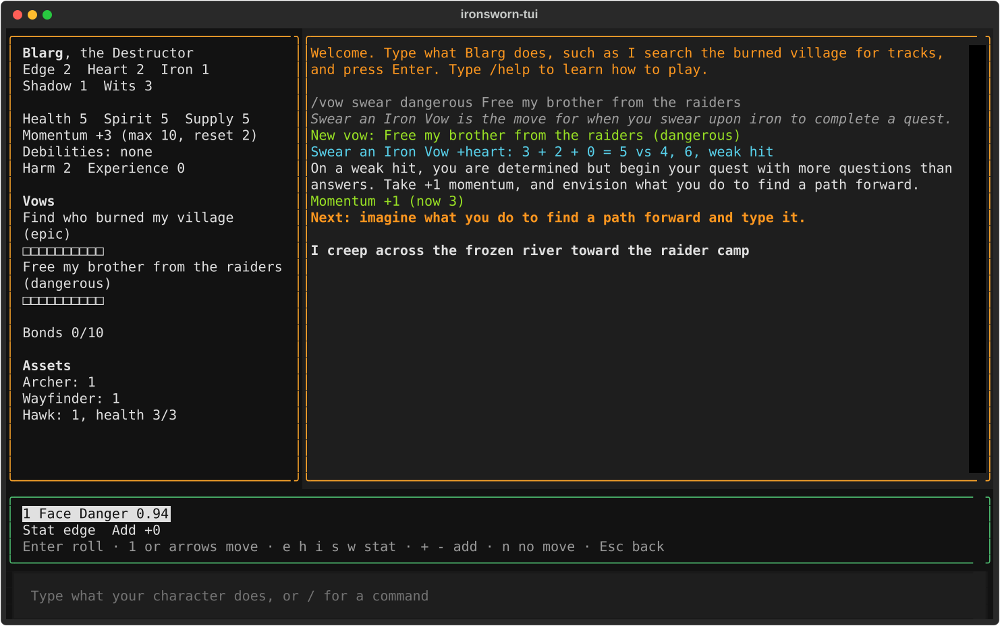
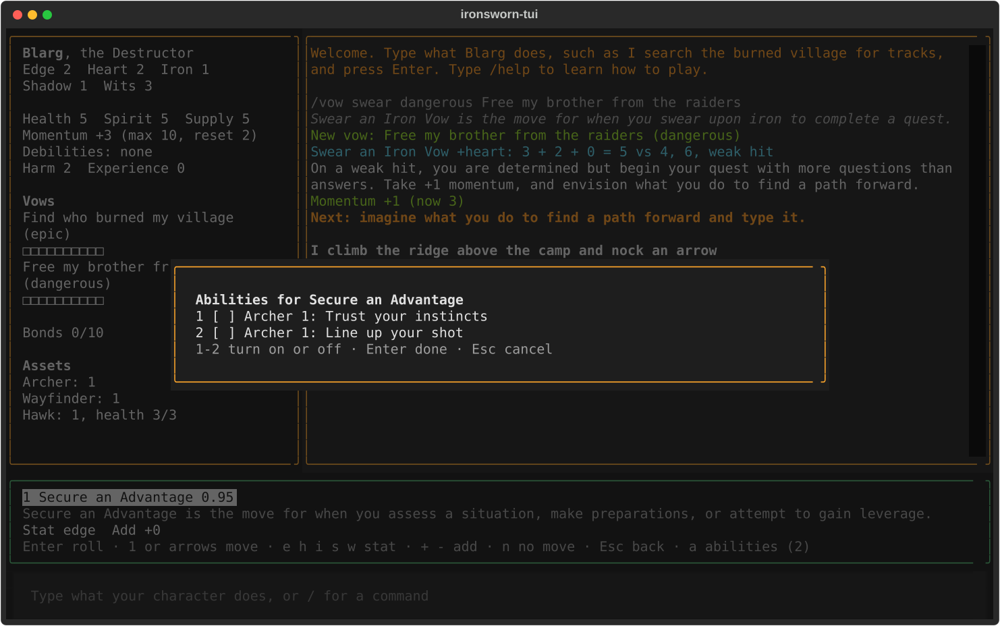

# Reference

`ironsworn-tui` is a terminal app for playing the solo tabletop RPG *Ironsworn*. It has four commands, a play screen with keys, and `/` commands you type while you play. For setup, see [Getting started](getting-started.md). For step-by-step tasks, see [How-to guides](how-to.md). For what the moves and rules mean, see [Playing Ironsworn](playing.md).

Terms:

- **Campaign**: one character and their game, saved as one JSON file.
- **Decision model**: the hosted model that reads each message you type and suggests the move it triggers. The app reaches it through jevtester, a separate tool that runs on your computer.
- **Target**: the jevtester name of the model to ask, such as `decision-1@foundry`.
- **Context**: the situation, which sets the moves the app offers. It's `exploring` (no fight and no journey), `journey` (a journey and no fight), or `fight` (a fight, with or without a journey).
- **Case**: a saved record of one turn: what the decision model saw, and the move you made.
- **Follow-up**: a move the rules make you take next, such as Pay the Price or Endure Harm.

## Command line

```text
ironsworn-tui <command> [options]
```

| Command | What it does |
|---|---|
| [`new`](#ironsworn-tui-new) | Creates a character and a campaign file. |
| [`play`](#ironsworn-tui-play) | Opens a campaign in the play screen. |
| [`suggest`](#ironsworn-tui-suggest) | Prints the moves the decision model suggests for one message. |
| [`write-suites`](#ironsworn-tui-write-suites) | Writes the decision model's test suites. |

`ironsworn-tui --help` and `ironsworn-tui <command> --help` print the same information in short form.

### Exit status

| Status | Meaning |
|---|---|
| `0` | The command succeeded. |
| `2` | The arguments didn't parse, an option wasn't valid, the settings file couldn't be read or wasn't valid, or a campaign file was missing, already existed, or couldn't be loaded. The command prints `Error:` and the reason, or argparse's usage message, to standard error. |
| `3` | `suggest` only: jevtester couldn't answer, or the model gave no answer. |

### ironsworn-tui new

```text
ironsworn-tui new <name> --description <text> --stats <stat>=<n>,... --assets <asset>[:<ability>],... --vow <text> [--bond <text>]... [--rank <rank>] [--harm 1|2]
```

Creates a character and a campaign with one background vow. Saves it as `<name>.json` in the campaigns folder, and prints the file's path to standard output. The character starts with full health, spirit, and supply, +2 momentum, and 0 experience.

| Argument or option | Required | Default | Value |
|---|---|---|---|
| `<name>` | Yes | | The character's name. It's also the campaign's name and the file name, and it's case-sensitive. |
| `--description` | Yes | | A few words about the character, such as `"a hunter"`. |
| `--stats` | Yes | | All five stats (`edge`, `heart`, `iron`, `shadow`, `wits`), given the values 3, 2, 2, 1, and 1 in any order. Write each as `<stat>=<n>` and separate them with commas and no spaces. |
| `--assets` | Yes | | Exactly three asset ids, separated by commas with no spaces. Ids are lowercase, such as `archer` or `cave_lion`. An asset that starts with no ability marked, such as a companion, needs the ability to mark after a colon, from 1 to 3, such as `hawk:2`. An asset that starts with an ability marked takes no colon. `/asset list` in the play screen lists the ids. |
| `--vow` | Yes | | The background vow's text. |
| `--bond` | No | None | A person or community the character shares a background bond with. Repeat it for up to three bonds. Each marks one tick on the bonds track and logs `Bond: <text>`. |
| `--rank` | No | `epic` | The background vow's rank: `troublesome`, `dangerous`, `formidable`, `extreme`, or `epic`. Case doesn't matter. |
| `--harm` | No | `2` | The harm the character deals: `2` with a deadly weapon, `1` without. |

Errors, each with exit status 2. The command writes nothing when one occurs.

| Message | Cause |
|---|---|
| `Error: <path> already exists` | A campaign with that name exists. Choose another name, or delete the file. |
| `Error: stats must be assigned from (3, 2, 2, 1, 1), got {...}` | A stat is missing, or the values aren't 3, 2, 2, 1, 1. |
| `Error: unknown stat '<word>'` | A name in `--stats` isn't one of the five stats. A space after a comma causes this. |
| `Error: invalid literal for int() with base 10: '<value>'` | A stat value isn't a whole number. |
| `Error: pick 3 assets, got <n>` | `--assets` doesn't list three assets. |
| `Error: pick 3 different assets, got <ids>` | `--assets` lists the same asset twice. |
| `Error: a character starts with up to 3 bonds` | `--bond` is given more than three times. |
| `Error: unknown asset id: <id>` | An asset id doesn't exist. Ids are lowercase, and a space after a comma causes this. |
| `Error: <Asset> starts with no ability marked; pick one from 1 to 3` | A companion or similar asset has no `:<ability>`. |
| `Error: <Asset> already starts with an ability marked` | An asset that starts with an ability marked has `:<ability>`. |
| `Error: write a pick as an ability number, such as <id>:1` | The text after the colon isn't a number. |
| `Error: buy <Asset> with /asset buy once you play, to choose its stat changes` | The pick is Shadow-Kin 1 or Battle-Scarred 1, which change stats. |
| `Error: rank must be one of: troublesome, dangerous, formidable, extreme, epic` | `--rank` isn't a rank. |

Example:

```console
$ ironsworn-tui new Kira --description "a hunter" \
    --stats edge=3,heart=2,iron=2,shadow=1,wits=1 \
    --assets archer,hawk:2,wright \
    --vow "Avenge my village"
/path/to/ironsworn-tui/campaigns/Kira.json
```

See also: [`ironsworn-tui play`](#ironsworn-tui-play).

### ironsworn-tui play

```text
ironsworn-tui play <name> [--no-model]
```

Opens the campaign saved as `<name>.json` in the campaigns folder in the [play screen](#play-screen). The app saves the campaign file after every change, so there's no save command. To quit, press Ctrl+Q.

Without `--no-model`, the app prints `Starting jevtester for <target>…` to standard error and starts jevtester. It then asks the decision model about each message you type, which can cost money. It saves a [case](#case-files) for each answered message you make a move for. If jevtester doesn't start, the app opens anyway, and the log shows `Playing without move suggestions:` and the reason.

| Argument or option | Required | Default | Value |
|---|---|---|---|
| `<name>` | Yes | | The campaign's name, as given to `ironsworn-tui new`. Case-sensitive. |
| `--no-model` | No | Off | Play without move suggestions. The app doesn't start jevtester and saves no cases. Each message you type shows every move in the context. |

Errors, each with exit status 2:

| Message | Cause |
|---|---|
| ``Error: no campaign at <path>. Create one with `ironsworn-tui new`.`` | No campaign file has that name. |
| `Error: can't load <path>: <reason>` | The file can't be read or isn't a valid campaign. |
| `Error: can't play <path>: unknown lasting effects: <names>` | The campaign has a lasting effect that isn't in this version's list of lasting effects. |

Example:

```console
$ ironsworn-tui play Kira --no-model
```

### ironsworn-tui suggest

```text
ironsworn-tui suggest <text> [--context exploring|journey|fight] [--initiative character|foe] [--name <name>] [--character <text>] [--situation <text>] [--style guide|trigger] [--target <target>]
```

Asks the decision model which move one message triggers. It starts jevtester, sends one request, and prints the result. It reads and saves no campaign. Each run can cost money.

| Argument or option | Required | Default | Value |
|---|---|---|---|
| `<text>` | Yes | | The message, as the player would type it. |
| `--context` | No | `exploring` | The context, which sets the moves the model chooses from. |
| `--initiative` | No | `character` in a fight | Who has initiative. Ignored unless `--context fight`. |
| `--name` | No | `Kira` | The character's name. |
| `--character` | No | `Kira, a hunter` | The character, as the model sees it. |
| `--situation` | No | Empty | The scene, as [`/scene`](#scene) sets it in play. |
| `--style` | No | `guide` | How the request describes each move. `guide` uses short criteria. `trigger` uses the move's trigger text from the rules data. |
| `--target` | No | `target` in [`ironsworn-tui.toml`](#settings) | The jevtester target to ask. |

Output, on standard output:

```text
Target: <target>, <latency> ms
Confidence: <confidence>, top to second: <ratio>
1. <Move>: <probability>
2. <Move>: <probability>
3. <Move>: <probability>
Stat: <stat> (<probability>)
```

The `Stat:` line appears only when the top move rolls with a stat the player chooses. The ratio is `inf` when the second move's probability is 0.

Errors, each with exit status 3:

| Message | Cause |
|---|---|
| `Error: <reason>`, on standard error | jevtester didn't start or didn't answer. |
| `No suggestion: <reason>`, on standard output | The model answered without a move. |

Example:

```console
$ ironsworn-tui suggest "I swing my axe at the raider" --context fight --situation "A burned village"
```

### ironsworn-tui write-suites

```text
ironsworn-tui write-suites
```

Writes the decision model's question sets and recognizer suites under `suites/` from `experiments/recognizer-phrasings.yaml`, replacing the files there. Then it creates `suites/play-<context>.yaml` for each context that doesn't have one. It never changes an existing play suite, because play suites hold the cases saved in play. It prints the path of each file it writes. It calls no model. Both folders are in the repository, beside the `ironsworn_tui` package.

Example, with output shortened:

```console
$ ironsworn-tui write-suites
suites/question-sets/moves-exploring-guide.yaml
suites/recognizer-exploring-guide.yaml
...
suites/question-sets/moves-fight-guide-acts.yaml
suites/recognizer-fight-guide-acts.yaml
```

## Play screen

The play screen has four parts:

- **Character panel**, on the left: stats, health, spirit, supply, momentum, debilities, harm, experience, the add for the next move, assets, vows, bonds, and, when they're active, the journey and the fight. In a fight, `>` marks the foe an attack targets. Each progress track shows 10 boxes.
- **Log**, on the right: the campaign log. On opening, it shows the last 50 entries.
- **Suggestion bar**, below them: suggested moves, the roll card, and owed moves. Its keys depend on its [mode](#suggestion-bar).
- **Input line**, at the bottom: where you type a message or a `/` command.



Log colors:

| Color | Entry |
|---|---|
| Bold | A message you typed. |
| Cyan | A roll. |
| Green | An outcome, an oracle result, or a command's output. |
| Yellow | A note, such as an error or a reminder. |
| Dim | A command you ran, and what it changed. |

### Keys everywhere

| Key | Action |
|---|---|
| Ctrl+Q | Quit. The campaign is already saved. |
| Tab, Shift+Tab | Move focus between the log, the suggestion bar, and the input line. |
| Ctrl+P | Open the command palette of Textual, the framework the app is built on. |

### Input line

| Key | Action |
|---|---|
| Enter | Send the line. Empty lines are ignored. |

What Enter does with the text:

- **Text starting with `/`** runs a [`/` command](#commands). You can run commands while a follow-up is owed, but not while a roll card is waiting.
- **Other text** is a message. The app saves it to the campaign log, and the bar shows `Thinking…` while the decision model answers. The input line is disabled until the answer arrives. With `--no-model`, the answer is immediate. The bar then shows the suggestions.
- **While a roll card is waiting, or before an owed follow-up**, the app doesn't send a message. The log shows `Finish the roll first`, and the bar shows the card or the follow-up again.

### Suggestion bar

The bar takes keys only while it has focus. It shows the keys it takes on its last line. It has these modes:

| Mode | When | Bar shows |
|---|---|---|
| Idle | Nothing is waiting. | The list of `/` commands. Focus is on the input line. |
| Thinking | The decision model is answering a message. | `Thinking…`. The bar takes no keys. |
| Suggest | The model answered, or you ran `/moves`. | Moves to choose from, the stat, the add, and turned-on abilities. |
| Card | A move was rolled. | The roll card: the result, its outcome, and any choices. |
| Follow-up | A follow-up move is owed. | The owed move. |
| Offer | A strong hit on an attack lets you make End the Fight. | The offer. |

#### Suggest mode

Which moves appear depends on the model's confidence in its top move:

- **High confidence:** only the top move, selected.
- **Middle confidence:** the top two moves, the first selected.
- **Low confidence, a failed request, `--no-model`, or `/moves`:** every move in the context, plus moves your assets add, none selected.
- **Top answer is no move or can't tell:** `No move` above every other move, none selected.

The `act` and `confirm` thresholds in `suites/policies/moves.yaml` set the confidence bands.

Each move shows its key and, when the model answered, its probability. The selected move is highlighted. Below the moves, `Stat <stat>` shows the stat the roll will use, for a move where you choose one. The model's suggested stat is set when you select the move, and `not set` means you must pick one. `Add +<n>` shows your add.

| Key | Action |
|---|---|
| 1 to 9 | Select the move with that number. |
| Left, Up | Select the previous move. |
| Right, Down | Select the next move. Moves past the ninth show `·` and are reached only with arrows. |
| `e`, `h`, `i`, `s`, `w` | Set the stat to edge, heart, iron, shadow, or wits. |
| `+`, `-` | Raise or lower the add by 1. |
| `a` | Open the [abilities picker](#pickers) for the selected move. Shown as `a abilities (<n>)` only when an asset ability applies. |
| Enter | Roll the selected move. If the move needs details first, the [details form](#details-form) opens. The bar then shows the roll card. |
| `n` | Make no move. The log shows `No move`. If the model answered the message, the app saves this as a case. |
| Escape | Leave the message without a move, and return to the input line. The app saves no case. |

#### Card mode

The card shows `<Move> +<stat>: <result>`, the abilities used, and the outcome text. When the outcome asks you to choose, the card lists numbered options under a prompt such as `Choose one:` or `Choose up to 2:`.

| Key | Action |
|---|---|
| 1 to 9 | Turn an option of the current choice on or off. In a choose-one, it replaces the picked option. |
| Enter | Confirm the current choice, then the next. After the last choice, or when there's none, apply the outcome and save. |
| `r` | Open the dice picker to reroll dice. Shown only when an asset ability allows a reroll. |
| `+` | Take an asset's add after rolling, and its cost. Shown only when an ability allows it. |
| `b` | Burn momentum. Shown only when burning would improve the result. |

Rerolling, adding after rolling, and burning momentum clear the choices you've picked on the card. Escape does nothing on a card. A waiting roll card isn't saved in the campaign file, so quitting before you apply it discards it.

#### Follow-up mode

The bar shows the owed move and, for an endure move, the amount.

| Owed move | Key | Action |
|---|---|---|
| Pay the Price | `o` | The most obvious negative outcome happens. |
| Pay the Price | `a` | Ask the oracle, at likely odds, whether the outcome you think likelier happens. |
| Pay the Price | `t` | Roll on the Pay the Price table. |
| Forsake Your Vow | Enter | Clear the vow. Endure Stress is owed next. |
| Endure Harm, Endure Stress, Companion Endure Harm, Face Death, Face Desolation, Scrape By | Enter | Roll the move. The bar then shows its roll card. |
| The same rolled moves | `a` | Open the abilities picker. Shown only when an ability applies. |

#### Offer mode

| Key | Action |
|---|---|
| `f` | Make End the Fight. The bar shows its roll card. |
| `a` | Open the abilities picker for End the Fight. Shown only when an ability applies. |
| Escape | Decline the offer and return to the input line. The fight goes on. |

### Pickers

The abilities picker (`a`) lists the asset abilities that apply to a move. The dice picker (`r`) lists `Action die`, `First challenge die`, and `Second challenge die`. A progress roll has no action die, so it lists only the challenge dice. `[x]` marks a picked item.



| Key | Action |
|---|---|
| 1 to 9, then `a` to `z` | Pick an item, or unpick it. |
| Enter | Close the picker and keep the picks. In the dice picker, reroll the picked dice. |
| Escape | Close the picker and change nothing. |

### Details form

Some moves ask for details before they roll. The form shows one field for each detail:

| Field | Moves | Value |
|---|---|---|
| Vow | Swear an Iron Vow; Fulfill Your Vow and Forsake Your Vow when you have more than one vow | The vow's text, or the name of an existing vow, exactly as written. |
| Rank | Swear an Iron Vow, Undertake a Journey (a new journey) | `troublesome`, `dangerous`, `formidable`, `extreme`, or `epic`. |
| Foes | Enter the Fray, Draw the Circle | Each foe's name and rank, separated by commas, such as `Raider chief dangerous, Archer troublesome`. |
| Destination | Undertake a Journey (a new journey) | The journey's destination. |
| Treat | Heal | `yourself` (the default when empty), `someone else`, or a companion's asset name, id, or given name. |
| Amount | A move with Lightbearer's unleashed light turned on | How much of the asset's meter to spend, as a whole number. |

| Key | Action |
|---|---|
| Enter | Move to the next field. In the last field, submit the form. An invalid value shows an error in the form. |
| Escape | Close the form without rolling. |

## Commands

Type a command in the input line and press Enter. The command name is case-sensitive and lowercase. An unknown command shows the list of commands. An error appears as a yellow note in the log, and it changes nothing. Every command that changes the campaign writes a log entry and saves the campaign file. Lines a command only shows, such as a list, aren't saved to the campaign log.

Names you type:

- **Vow and foe names** must match exactly, including case.
- **Asset names** can be the id (`cave_lion`), the id with hyphens (`cave-lion`), or the asset's name (`Cave Lion`). Case doesn't matter.
- **Ranks** are `troublesome`, `dangerous`, `formidable`, `extreme`, and `epic`. Case doesn't matter.
- **Stat changes** in `/asset buy` and `/asset upgrade` are `+<stat>` or `-<stat>`, one per stat point.

| Command | What it does |
|---|---|
| [`/oracle`](#oracle) | Rolls on an oracle table. |
| [`/ask`](#ask) | Asks the yes or no oracle. |
| [`/vow`](#vow) | Lists, swears, marks, fulfills, or forsakes vows. |
| [`/scene`](#scene) | Sets the scene text. |
| [`/target`](#target) | Picks the foe an attack targets. |
| [`/tide`](#tide) | Arms or disarms Turn the Tide. |
| [`/adjust`](#adjust) | Changes a value by hand. |
| [`/endure`](#endure) | Owes Endure Harm or Endure Stress. |
| [`/asset`](#asset) | Lists, shows, buys, and changes assets. |
| [`/effects`](#effects) | Lists or ends lasting effects. |
| [`/moves`](#moves) | Shows every move in the context. |

### /oracle

```text
/oracle <table>
```

Rolls on an oracle table, writes the result to the log, and saves. `<table>` is a full table id or any ending of one after a `/`, such as `action`, `region`, or `character/descriptor`. Some tables roll on other tables, and those results appear indented below.

Tables, by full id:

- `classic/action_and_theme/action`, `classic/action_and_theme/theme`
- `classic/character/descriptor`, `classic/character/goal`, `classic/character/role`
- `classic/fate/ask_the_oracle/almost_certain`, `.../fifty_fifty`, `.../likely`, `.../small_chance`, `.../unlikely`
- `classic/fate/pay_the_price/pay_the_price`
- `classic/name/elf`, `classic/name/ironlander/a`, `classic/name/ironlander/b`, `classic/name/other/giants`, `classic/name/other/trolls`, `classic/name/other/varou`
- `classic/place/coastal_waters_location`, `classic/place/descriptor`, `classic/place/location`, `classic/place/region`
- `classic/settlement/name`, `classic/settlement/name/creature`, `classic/settlement/name/environmental_aspect`, `classic/settlement/name/historical_event`, `classic/settlement/name/landscape_feature`, `classic/settlement/name/manmade_edifice`, `classic/settlement/name/old_world_language`, `classic/settlement/name/something_else`, `classic/settlement/quick_name/prefix`, `classic/settlement/quick_name/suffix`, `classic/settlement/trouble`
- `classic/suffer/endure_harm/endure_harm`, `classic/suffer/endure_stress/endure_stress`
- `classic/turning_point/challenge_rank`, `classic/turning_point/combat_action`, `classic/turning_point/major_plot_twist`, `classic/turning_point/mystic_backlash`

| Error | Cause |
|---|---|
| `usage: /oracle <table>` | No table given. |
| `no oracle table named '<name>'` | No table id is or ends with the name. |
| `'<name>' could be: <ids>` | More than one table matches, such as `descriptor`. Use a longer ending. |

```text
/oracle action
Oracle classic/action_and_theme/action, 42: Demand
```

### /ask

```text
/ask <likelihood>
```

Asks the yes or no oracle (Ask the Oracle), writes the answer to the log, and saves. `<likelihood>` is `almost certain`, `likely`, `50/50`, `unlikely`, or `small chance`, in any case. The log adds `, match` when the roll is a match.

| Error | Cause |
|---|---|
| `likelihood must be one of: almost certain, likely, 50/50, unlikely, small chance` | The likelihood is missing or not on the list. |

```text
/ask likely
Ask the Oracle (likely), 84: yes
```

### /vow

```text
/vow
/vow swear <rank> <vow>
/vow mark [<vow>]
/vow fulfill [<vow>]
/vow forsake [<vow>]
```

| Form | What it does |
|---|---|
| `/vow` | Shows each active vow as `<vow> (<rank>): <boxes>/10`, or `No vows`. Changes nothing. |
| `/vow swear <rank> <vow>` | Makes Swear an Iron Vow for a new vow, and shows the roll card. The vow appears in the panel with the card, and it's saved when you apply the card. |
| `/vow mark [<vow>]` | Reaches a Milestone: marks progress on the vow for its rank, and saves. |
| `/vow fulfill [<vow>]` | Makes Fulfill Your Vow, a progress roll, and shows the roll card. |
| `/vow forsake [<vow>]` | Makes Forsake Your Vow at once: clears the vow and owes Endure Stress. Saves. |

`<vow>` can be left out when you have one vow.

| Error | Cause |
|---|---|
| `usage: /vow swear <rank> <vow>` | The rank or the vow is missing. |
| `rank must be one of: troublesome, dangerous, formidable, extreme, epic` | The first word after `swear` isn't a rank. |
| `name the vow` | You have more than one vow and gave no name. |
| `"no vow named '<vow>'"` | No active vow has that name. |
| `Make the owed <move> first` | A follow-up is owed (`swear`, `fulfill`, `forsake`). |
| `usage: /vow [swear <rank> <vow> \| mark \| fulfill \| forsake <vow>]` | The word after `/vow` isn't one of the forms. |

```text
/vow swear dangerous Find my brother
Swear an Iron Vow +heart: 1 + 2 + 0 = 3 vs 9, 2, weak hit
/vow mark Find my brother
Reach a Milestone: Find my brother is at 2/10
```

### /scene

```text
/scene <text>
```

Replaces the scene text, which the decision model reads with each message. Logs `Scene: <text>` and saves.

| Error | Cause |
|---|---|
| `usage: /scene <text>` | No text given. |

```text
/scene A ruined watchtower in the rain
Scene: A ruined watchtower in the rain
```

### /target

```text
/target <foe>
```

Picks the foe in the current fight that attacks target. Logs `Target: <foe>` and saves. Without a pick, attacks target the first foe.

| Error | Cause |
|---|---|
| `usage: /target <foe>` | No name given. |
| `No foe named '<foe>' in the fight` | No foe in the fight has that exact name. |

```text
/target Raider chief
Target: Raider chief
```

### /tide

```text
/tide
/tide off
```

`/tide` arms Turn the Tide for your next move, and `/tide off` disarms it without using it. Each logs the change and saves. The character panel shows `Turn the Tide armed` while it's armed.

| Error | Cause |
|---|---|
| `Turn the Tide needs a fight where the foe has initiative` | There's no fight, or you have initiative. |
| `Turn the Tide was already used in this fight` | It can be used once in each fight. |
| `usage: /tide [off]` | Any word other than `off`. |

```text
/tide
Turn the Tide is armed
```

### /adjust

```text
/adjust health|spirit|supply|momentum|experience|bonds <n>
/adjust <debility> mark|clear
/adjust vow|foe <name> <ticks>
/adjust journey <ticks>
/adjust harm 1|2
/adjust fight end
```

Changes a value by hand, without a move. `<n>` and `<ticks>` are whole numbers, positive or negative, such as `-2` or `+1`. Each form logs `Adjust:` and the new value, and saves. A progress track has 40 ticks, 4 to a box. Arguments are split as a shell splits them, so you can quote a name.

| Form | What it changes |
|---|---|
| `health`, `spirit`, `supply` `<n>` | Adds `<n>` to the meter, within 0 and its maximum. A marked wounded stops health from rising, and a marked shaken stops spirit from rising. |
| `momentum <n>` | Adds `<n>` to momentum, within -6 and the maximum. |
| `experience <n>` | Adds `<n>` to experience, not below 0. |
| `bonds <n>` | Adds `<n>` ticks to the bonds track, within 0 and 40. |
| `<debility> mark\|clear` | Marks or clears `wounded`, `shaken`, `unprepared`, `encumbered`, `maimed`, `corrupted`, `cursed`, or `tormented`. |
| `vow <name> <ticks>`, `foe <name> <ticks>` | Adds ticks to the named vow's or foe's track, within 0 and 40. |
| `journey <ticks>` | Adds ticks to the journey's track, within 0 and 40. |
| `harm 1\|2` | Sets the harm the character deals. |
| `fight end` | Ends the fight without End the Fight. Logs `The fight ends: by hand`. |

After any form but `fight end`, lasting effects that last only while health, spirit, and momentum are above 0 end if one of them is 0 or below.

| Error | Cause |
|---|---|
| `usage: /adjust ...` | The form isn't on the list, or has the wrong number of arguments. |
| `'<text>' isn't a number` | The amount isn't a whole number. |
| `no vow named '<name>'`, `no foe named '<name>'` | No vow or foe has that exact name. |
| `there's no journey` | `journey` with no active journey. |

```text
/adjust health -2
Adjust: Health -2, now 3
/adjust vow Find my brother 4
Adjust: Find my brother is now 12 ticks
```

### /endure

```text
/endure harm|stress <n>
```

Owes Endure Harm (`harm`) or Endure Stress (`stress`) for `<n>` harm or stress, which must be at least 1. Use it when the fiction hurts your character and no move result owed the roll, such as a foe's attack or Pay the Price. The move joins the end of the follow-up list, and the suggestion bar asks you to roll it. Logs `<name> faces <n> harm` or `<name> faces <n> stress`, and saves.

| Error | Cause |
|---|---|
| `usage: /endure harm\|stress <n>` | The form isn't `harm` or `stress` followed by an amount. |
| `'<text>' isn't a number` | The amount isn't a whole number. |
| `the harm or stress must be at least 1` | The amount is 0 or less. |

```text
/endure harm 2
Kira faces 2 harm
```

### /asset

```text
/asset
/asset list [<category>]
/asset show <asset>
/asset buy <asset> [<ability>] [+<stat> -<stat> ...]
/asset upgrade <asset> <ability> [+<stat> -<stat> ...]
/asset meter <asset> <meter> <n>
/asset set <asset> <field> <value>
/asset debility <asset> on|off
/asset harm <companion> <n>
/asset use lorekeeper
/asset use slayer ritual|sojourn
/asset discard <asset>
```

| Form | What it does |
|---|---|
| `/asset` | Shows each owned asset as `<Asset> (<given name>): <marked abilities>, <meter> <value>/<max>, <field> <value>`. Changes nothing. |
| `/asset list [<category>]` | Shows every asset as `<id>: <Asset>`, or only those in `combat_talent`, `companion`, `path`, or `ritual`. Changes nothing. |
| `/asset show <asset>` | Shows the asset's category, requirement, and abilities, with `[x]` on marked ones. For an owned asset, adds its summary. Changes nothing. |
| `/asset buy <asset> [<ability>] [...]` | Spends 3 experience on a new asset. An asset that starts with no ability marked needs `<ability>`, from 1 to 3. For Shadow-Kin 1 and Battle-Scarred 1, give the ability number, then the stat changes. |
| `/asset upgrade <asset> <ability> [...]` | Spends 2 experience to mark an ability of an owned asset. Give stat changes after the ability number when it calls for them. |
| `/asset meter <asset> <meter> <n>` | Adds `<n>` to an asset's meter, such as a companion's `health`, within 0 and its maximum. |
| `/asset set <asset> <field> <value>` | Fills in a text or choice field, such as a companion's `name`. The value can have spaces. Setting Ironclad's `equipped` to `geared_for_war` marks encumbered, and changing it from that clears encumbered. |
| `/asset debility <asset> on\|off` | Makes the asset count as a debility, or stop counting, as Fated and Leech call for. |
| `/asset harm <companion> <n>` | Owes Companion Endure Harm for `<n>` harm. The bar shows it as a follow-up. |
| `/asset use lorekeeper` | Uses Lorekeeper's third ability, one time only: raises wits by 1, to at most 5, and rolls a die. On 1 to 3, the app adds a log entry telling you to mark corrupted (`/adjust corrupted mark`) or Face Desolation. |
| `/asset use slayer ritual\|sojourn` | Uses Slayer's third ability: adds a trophy as a lasting effect, for a ritual or a sojourn. |
| `/asset discard <asset>` | Removes an owned asset. |

Animal Kin 2 (companions other than Kindred), Ritualist 3 (rituals), and Weaponmaster 2 (combat talents) lower the cost of `buy` and `upgrade` by 1. Every form that changes the campaign logs `Asset:` and the change, and saves.

| Error | Cause |
|---|---|
| `usage: /asset [...]` | The form isn't on the list, or has the wrong arguments. |
| `no asset named '<word>'; /asset list shows them` | No asset matches the name. |
| `categories: combat_talent, companion, path, ritual` | The category isn't one of these. Write `combat_talent` with an underscore. |
| `that costs <n> experience, and <character> has <m>` | Not enough experience. |
| `<character> already owns <Asset>` | `buy` for an owned asset. |
| `<character> doesn't own <id>` | The form needs an owned asset. |
| `<Asset>'s ability <n> is already marked` | `upgrade` for a marked ability. |
| `<Asset>'s abilities are numbered 1 to 3` | The ability number is out of range. |
| `<Asset> starts with no ability marked; pick one from 1 to 3` | `buy` without `<ability>` for an asset that needs it. |
| `write a stat change as +stat or -stat, such as +wits, not '<word>'` | A stat change isn't written as `+<stat>` or `-<stat>`. |
| `<Asset>'s ability <n> doesn't change a stat` | Stat changes for an ability that makes none. |
| `Shadow-Kin: lower heart by 1 and raise shadow by up to 2` | Shadow-Kin 1's changes don't match the ability. |
| `Battle-Scarred: lower edge or iron by 1, and raise wits or heart by 2, or each by 1` | Battle-Scarred 1's changes don't match the ability. |
| `<Asset> can raise <stat> only to 4` | A raise would take the stat past 4. |
| `<stat> is already 0` | A lowered stat is 0. |
| `<Asset> has no meter '<meter>'` | The asset has no such meter. |
| `<Asset> has no field '<field>'; it has: <fields>` | The asset has no such field. |
| `<Asset>'s <field> must be one of: <choices>` | The value isn't one of the field's choices. |
| `<id> isn't a companion <character> has` | `harm` for an asset that isn't an owned companion. |
| `browsing the archive needs Lorekeeper's third ability` | `use lorekeeper` without the ability. |
| `the archive's forbidden depths can be browsed one time only` | `use lorekeeper` a second time. |
| `taking a trophy needs Slayer's third ability` | `use slayer` without the ability. |

```text
/asset buy cave lion 1
Asset: bought Cave Lion for 3 experience
/asset set hawk name Kestrel
Asset: Hawk name is now Kestrel
/asset
Archer: 1
Hawk (Kestrel): 2, health 3/3
Wright: 1
Cave Lion: 1, health 4/4
```

### /effects

```text
/effects
/effects end <number>
```

`/effects` shows the lasting effects, numbered, such as `1 Talisman`, or `No lasting effects`. `/effects end <number>` ends the effect with that number, and saves.

| Error | Cause |
|---|---|
| `there's no lasting effect <number>` | No effect has that number. |
| `usage: /effects [end <number>]` | Any other form. |

```text
/effects
1 Talisman
2 Pelt (edge)
/effects end 1
```

### /moves

```text
/moves
```

Shows every move in the context, then Aid Your Ally and the moves your assets add, in the suggestion bar in [suggest mode](#suggest-mode), with none selected. Changes nothing until you roll. Any text after `/moves` is ignored.

## Settings

The app reads `ironsworn-tui.toml` in the repository root, beside the `ironsworn_tui` package. The file must exist. There's no flag or environment variable for another path. Relative paths in it are relative to the file's folder, and `~` means your home folder.

| Key | Default | Value |
|---|---|---|
| `jevtester_project` | `~/repos/jevtester` | The jevtester checkout. The app runs `uv run --project <jevtester_project> jevtester` from it. |
| `target` | `decision-1@foundry` | The jevtester target that answers the decision questions in `play`, and in `suggest` without `--target`. The app also uses it to look up the confidence thresholds in `suites/policies/moves.yaml`. |
| `campaigns_dir` | `campaigns` | The folder for campaign files. |

A missing key takes its default. A missing or unreadable file, invalid TOML, an unknown key, a value of the wrong type, or a `jevtester_config` key stops the command with `Error:` and the reason, and exit status 2. jevtester reads its settings, including how it signs in to each target, from `jevtester.toml` beside `ironsworn-tui.toml`.

```toml
jevtester_project = "~/repos/jevtester"
target = "decision-1@foundry"
campaigns_dir = "campaigns"
```

## Files

| Path | Written by | Contents |
|---|---|---|
| `<campaigns_dir>/<name>.json` | `new`, and `play` after every change | The campaign: the character, vows, bonds, fight, journey, owed moves, lasting effects, and the full log. The app writes a `.tmp` file first and then replaces the campaign file, so a crash doesn't leave half a file. |
| `suites/play-exploring.yaml`, `suites/play-journey.yaml`, `suites/play-fight.yaml` | `write-suites` creates them; `play` adds cases through jevtester | Cases saved in play, one suite for each context. |
| `suites/question-sets/*.yaml`, `suites/recognizer-*.yaml` | `write-suites` | The decision model's question sets and recognizer suites. |
| `.jevtester/serve.log` | `play` and `suggest` | jevtester's server log, beside `jevtester.toml`. |

### Case files

When `play` runs with the model, the app saves a case each time you answer a message the model answered: by rolling a move from the suggestion bar, rolling a move with a `/` command such as `/vow swear`, or pressing `n`. The case goes to the end of `suites/play-<context>.yaml`, for the context the message was asked in. Each case has:

- An id made from the character's name and the time, such as `kira-20261025T143012123456`.
- The state the model saw, and the move you made, with its stat when the move rolls with a chosen stat.
- The tag `corrected` when you made a move other than the model's top answer, or `abstained` when the top answer was can't tell.

The app saves no case when you press Escape, when the request failed, when you play with `--no-model`, or for End the Fight. When the context changed since the message, the log shows `Case not saved: <move> wasn't offered then`. When jevtester refuses the case, the log shows `Case not saved:` and the reason.
